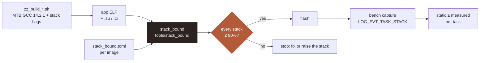

# ADR-0025: Static stack analysis with stack_bound (W46)

**Status:** proposed · 2026-11-11 · method in [stack_bound ADR-0001](../../../tools/stack_bound/docs/adr/ADR-0001-architecture.md) (accepted)

**Summary.** Every FreeRTOS task stack on both nodes is checked at build time by `stack_bound`
(submodule `tools/stack_bound`), against an 80% margin, before flashing. This ADR holds only this
project's choices: platform frames, project files, margin, the bench cross-check and the gate. The
first result is already a finding: Node B's `can` task has 5% margin (F-021).

## 1. Context

**Table 1.** Why this project needs it.

| Fact | Consequence |
|---|---|
| W40 (2026-09-28): Node B's `can` task overflowed on its first `crypto_mac()`, sized from a high-water mark taken before that path existed | Size stacks from every path, not the paths that ran |
| Stacks are sized from `uxTaskGetStackHighWaterMark` plus hand notes ("crypto_mac() alone needs ~540 B") | Replace the notes with checked numbers |
| Neither node's `can` task high-water is visible from the normal image (only health / heartbeat are) | The bench can't cross-check the task that overflowed (CLAUDE.md rule 7) |
| CI can't build firmware; MTB GCC 14.2.1 on both nodes | The real check runs locally, in the build scripts |

## 2. How it plugs into this project

**Figure 1.** The build checks every stack before flashing; the bench checks the tool.

## 3. Decisions

### D1. The method is stack_bound's; this ADR keeps only project choices

`stack_bound` is used as a pinned submodule. Its ADR-0001 owns the method: the ELF as referee, two
witnesses, function-pointer tiers, recursion, the stack model. This ADR doesn't repeat them.

*Rejected:* a project-local `host_tools/stack_drill.py` (the original plan). It would duplicate a
general tool, and the design grew past what one repo's script should hold.

### D2. Platform frames: Cortex-M4F / M7 with the FreeRTOS GCC port

**Table 2.** Context-switch frame on the task's own stack (PSP), for an FPU-using task.

| Pushed by | What | Bytes |
|---|---|---|
| Hardware, exception entry | `r0–r3, r12, lr, pc, xPSR` + `s0–s15, FPSCR` + reserved word | 104 |
| Hardware, alignment | 8-byte stack alignment on entry (`CCR.STKALIGN`) | 0–4 |
| `xPortPendSVHandler` | `vstmdbeq r0!, {s16-s31}` (task used the FPU) | 64 |
| `xPortPendSVHandler` | `stmdb r0!, {r4-r11, r14}` | 36 |
| **Total, worst case** | | **208** |

Counted once per task: a preempting ISR stacks the same hardware frame and PendSV tail-chains on it;
nested interrupts run on MSP. The bound is **208 B** (was 204 B before the alignment row was added on
2026-11-11). A task that never uses the FPU switches out with 72 B (32 + 4 + 36). These numbers go
into `stack_bound`'s Cortex-M FreeRTOS profile, with this table as their source. This corrects
ADR-0010's "~136 B" (FP registers only); ADR-0010 is amended by reference.

### D3. Project files: one `stack_bound.toml` per app image

`node_a_gateway/app/stack_bound.toml` and `node_b_actuator/proj_cm7/stack_bound.toml`. Tasks are
found automatically from the `xTaskCreateStatic` calls (stack_bound D9; the GCC 14 spike showed DWARF
records entry, depth and buffer). The files hold only what the binary can't tell:

**Table 3.** What each project file declares.

| Item | Node A | Node B |
|---|---|---|
| SecOC oracle binding → `crypto_mac` | yes | yes |
| `ipc_port_if_t` binding → `port_*` | yes | yes |
| `memcpy` / `memset` frames (from newlib-nano disassembly) | yes | yes |
| Policy `max_fallback` | `value` | `value` |

### D4. Margin: worst case ≤ 80% of the stack

`stack_bound`'s default rule, kept (changed from 85% on 2026-11-10). The 20% covers measured rather
than compiler-given frames, an indirect target missed in review, and the next small change to a
failure path (F-018's 160 B logging branch is the example). A fixed byte margin was rejected: 64 B is
generous on 512 B and nothing on 1.5 KB.

**Table 4.** Results, `stack_bound` 0.1.2 on both app images (GCC 14.2.1, 2026-11-11). Reports:
`docs/bench/2026-11-11/stack_bound_node*.txt`.

| Node | Task | Path | + switch | Stack before → after | Used | Status |
|---|---|---|---|---|---|---|
| A | `can_task` | 1280 B | 208 B | 384 → **512 w** | 97% → 73% | **F-021**, fixed (needs ≥ 466 w) |
| A | `app_task` | 1048 B | 208 B | 384 → **512 w** | 82% → 61% | **F-021**, fixed (needs ≥ 394 w) |
| A | `health_task` | 184 B | 208 B | 128 w | 77% | ok |
| A | `log_cyclic_task` | 100 B | 208 B | 128 w | 60% | ok |
| B | `can_task` | 1264 B | 208 B | 384 → **512 w** | 96% → 72% | **F-021**, fixed (needs ≥ 460 w) |
| B | `heartbeat_task` | 176 B | 208 B | 128 w | 75% | ok |
| B | `log_cyclic_task` | 100 B | 208 B | 128 w | 60% | ok |

The spike's 1256 B for Node B `can` missed `memcpy` (8 B). Node A's `app` task was not in the spike:
its transmit path (`secoc_secure → crypto_mac`) carries the same 568 B frame. Not analysed yet: the
FreeRTOS idle and timer tasks (newlib with no `.su`, see Table 7).

### D5. One new contract event: `LOG_EVT_TASK_STACK(task_id, free_words)`

Emitted for every task by the health task (Node A) and the heartbeat task (Node B) on the 5 s tick of
`LOG_EVT_APP_ALIVE`. `task_id` is a small per-node enum in `events.csv`; `free_words` is
`uxTaskGetStackHighWaterMark()`. The bench check asserts `static_worst ≥ STACK_WORDS − free_words`
per task. Cost: one record per task every 5 s (3 on Node A, 2 on Node B). `LOG_EVT_APP_ALIVE` keeps
its `stack_free_words` field unchanged (contract IDs are API).

*Rejected:* reading `g_hw_*` with the debugger (Node A only, outside the bench rule, not rerunnable
from a capture).

### D6. The gate: in the build scripts, after F-021 is fixed, no override

`zz_build_gateway_app.sh` and `zz_build_actuator_app.sh` run `stack_bound` after a successful build
and **stop before flashing** on failure. There's no override: a failing stack is fixed or raised. The
gate goes in only once every task passes D4 (F-021 first). The FBL is out of scope (super-loop on MSP,
no tasks; ADR-0004).

### D7. The analysis flags stay in the build permanently

`-fstack-usage -fcallgraph-info=su` in the `CFLAGS` of Node A `app` and Node B `proj_cm7`, so the
compiler witness always matches the image. The spike showed identical code bytes (`objcopy -O binary`
SHA-256 equal). Re-check on any toolchain bump, as one line of the `bench-test` build check.

## 4. Evidence: the Node B spike (2026-11-06)

**Table 5.** `proj_cm7` built with the flags, MTB GCC 14.2.1.

| Check | Result |
|---|---|
| Code bytes with the flags | identical to the normal build |
| Output | 215 `.su` + 215 `.ci`; all 2,326 frames static (no VLA, no `alloca`) |
| Indirect call sites | 7 functions: 6 SecOC oracle sites + `ipc_transact` |
| `can_task` with GCC's graph alone | **552 B**: stops at the oracle pointer |
| `can_task` with the oracle bound to `crypto_mac` | **1256 B**, ending in F-018's `crypto_report → log_evt` branch |

## 5. Consequences

**Table 6.** What it buys and costs this project.

| | Consequence |
|---|---|
| + | Stack sizes become checked numbers with a written path; the W40 class of overflow fails before flashing |
| + | Failure paths, rarely run on the bench, are covered by construction |
| + | No shipped-code change (identical bytes) |
| − | A new function-pointer site fails the build until its binding is declared |
| − | One more contract event (D5) |
| − | Paths that can't run together are still counted (here the failure branch is feasible: the Seam 6 GARBAGE run drove it 6,843 times) |

## 6. Open items

**Table 7.** Before acceptance or alongside W46.

| Item | Next step |
|---|---|
| ~~F-021~~ | Done 2026-11-11: three stacks raised to 512 words (Table 4); bench cross-check with D5 |
| Node A code bytes | Built with the flags and analysed (2026-11-11); identical bytes not yet compared |
| ~~`memcpy` / `memset` frames~~ | Done: 8 B (`push {r4, lr}`) and 0 B (leaf), newlib-nano, in both project files |
| FreeRTOS idle + timer tasks | Reach newlib with no `.su` (`_reclaim_reent` has an indirect `bx r3`): stack_bound's binary witness (slice 2) |
| MSP budget | Interrupt chain per core (stack_bound D9), after W46 |
