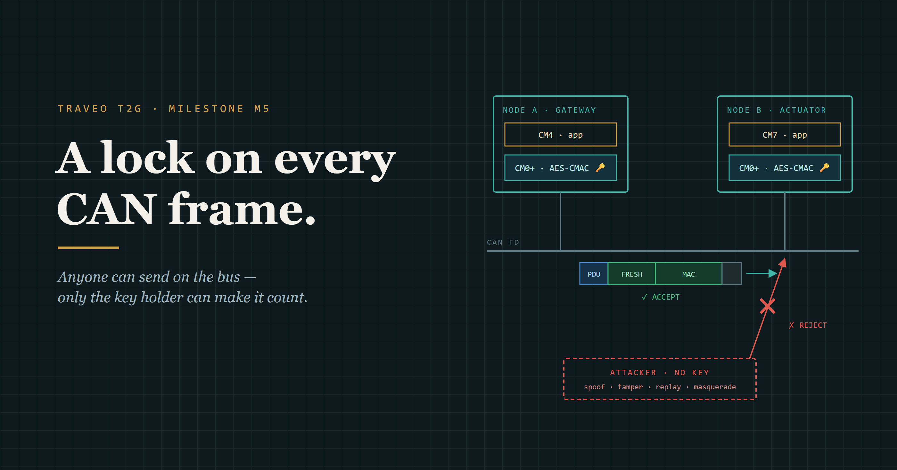
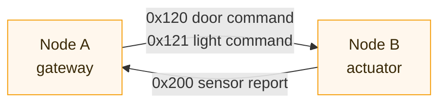
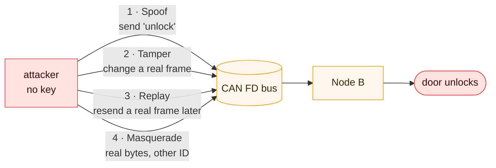
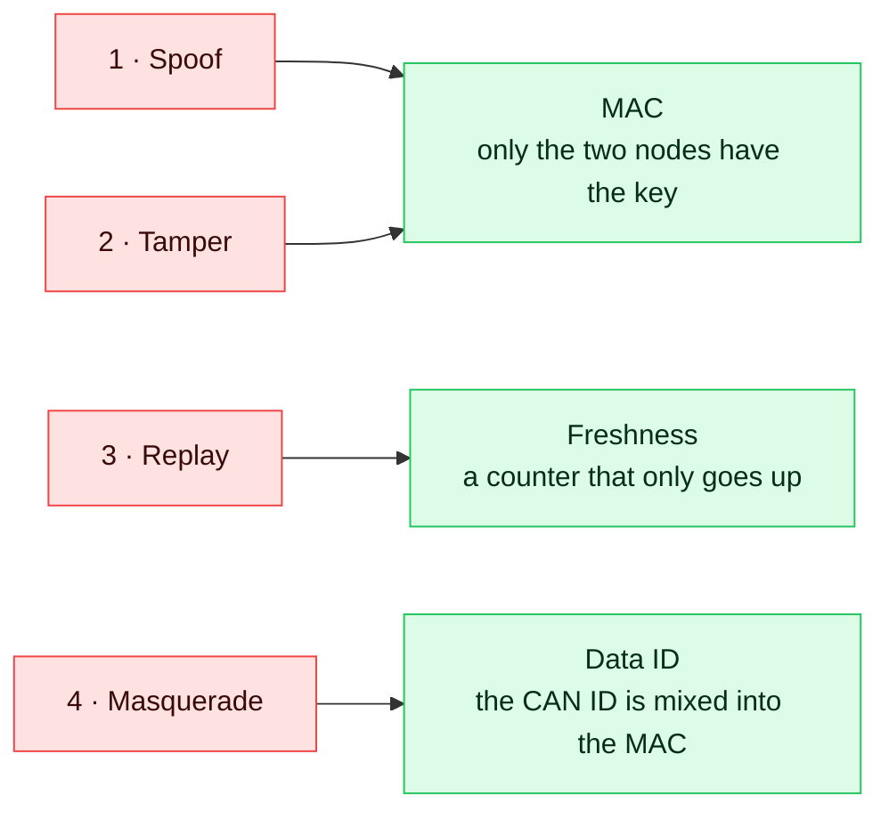
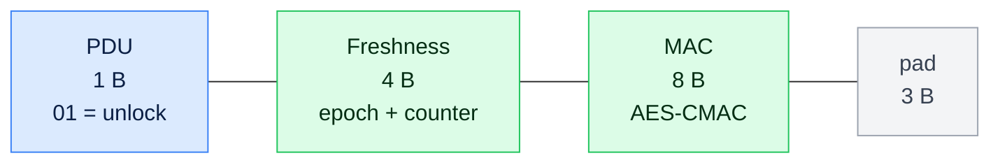
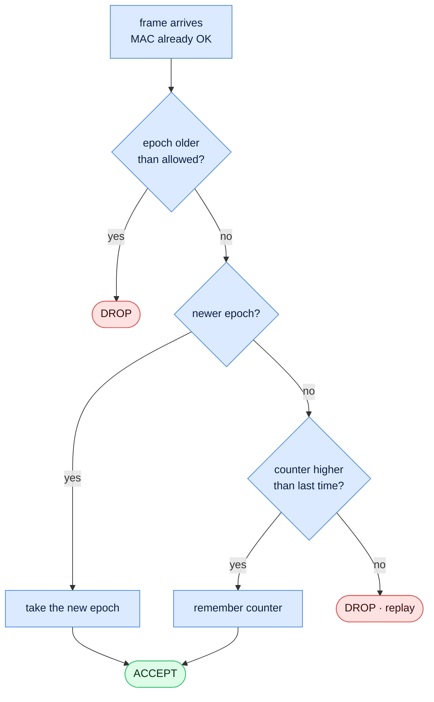
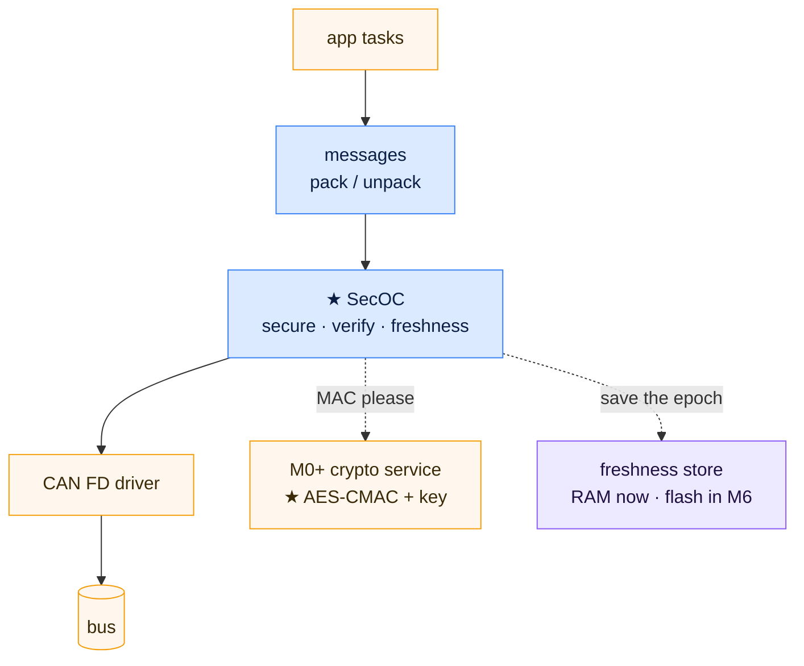
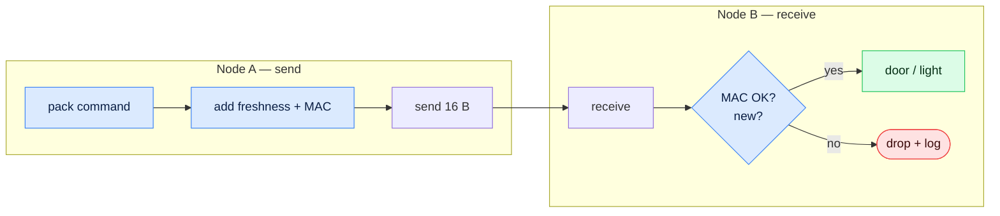
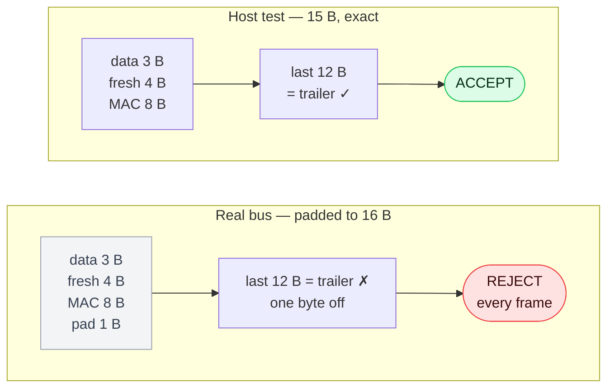
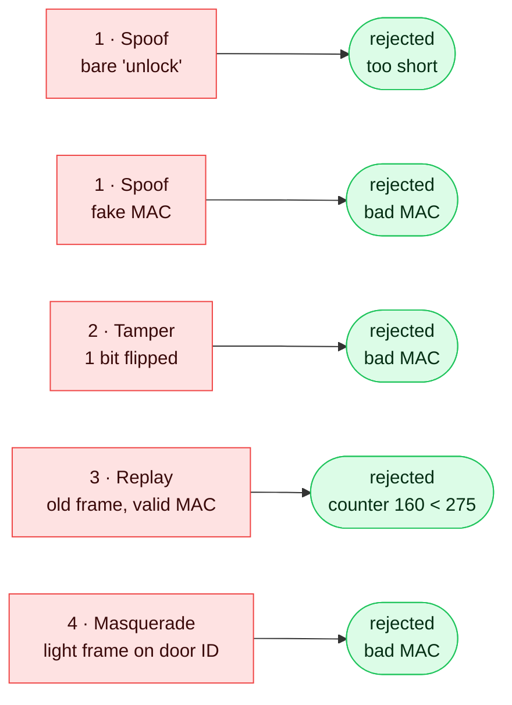

# M5 — Signing every CAN frame between two MCUs

*Part V of Traveo II Domain — building an automotive body-domain network from scratch on an Infineon TRAVEO™ T2G, with the design done in the open and Claude used as a visible collaborator.*



M4 ends with a promise: *"Symmetric crypto comes in M5 for authenticated messages (a MAC on CAN frames)."* This post keeps it.

M4 checks **which code runs**. M5 checks **which commands that code obeys**. Every frame between the two nodes now carries a MAC and a counter, and someone on the bus without the key can't unlock the door.

The plan is simple: the problem, the solution, how it's built, and the test. The test has a twist: all host tests passed, and the first real bus rejected every frame.

---

## 1. The problem

### What can an attacker do to a CAN frame?

Two nodes talk over CAN FD. Node A (the gateway) sends commands, and Node B (the actuator) drives the door lock and the light.



CAN has no idea who sent a frame. Any node can send any ID. So an attacker with a USB-CAN adapter (but no key) has four options:



*Before M5, all four end in the red box.*

Replay is the sneaky one. The replayed frame **is** real: it came from Node A and nobody changed it. Checking "who sent it" and "was it changed" isn't enough. The receiver also has to ask: **is it new?**

---

## 2. The solution

### One fix per attack

This is SecOC (Secure Onboard Communication), the AUTOSAR idea, in a simple form.



- A **MAC** alone stops spoofing and tampering. A replayed frame still has a valid MAC.
- **MAC + freshness** stops replay.
- **MAC + freshness + Data ID** stops all four. Without the Data ID, a fresh frame from one ID could pass on another.

The Data ID wasn't in my first design. I found the masquerade hole while reviewing it on paper, which is a much cheaper place to find it than on the bench.

### What a secured frame looks like



*Door command 0x120. The MAC covers the CAN ID + freshness + PDU, but the CAN ID isn't repeated inside the frame. Remember the grey pad box, it comes back in §4.*

```
MAC        AES-128-CMAC, cut to 8 bytes
Freshness  epoch (2 B) + counter (2 B)
Overhead   12 bytes per frame
Bus        CAN FD, 500 kbit/s / 2 Mbit/s
```

**Why only 8 bytes of MAC?** Every guess costs the attacker one frame on the bus, and the counter changes the MAC every time. So 8 bytes (1 in 2⁶⁴ per try) is plenty.

### Is it new? The freshness rule



- The **MAC is checked first**. A fake frame can never move the counter, so an attacker can't block real frames with junk.
- Each ID has its **own counter**, and all IDs share one **epoch** per boot. One flash write per boot, no matter how many IDs.

Honest — the counter lives in RAM, so replay protection resets when Node B reboots. M6 moves it to flash.

### Where the key lives

The key is on the **M0+**, the same security core M4 uses to check the app. The app core never sees the key. It can only ask the M0+: "give me a MAC over these bytes". That's the opcode M4 kept free for M5.

Honest — both nodes share one key, built into the M0+ image. Real cars use a key per ECU.

---

## 3. The implementation

### A new brick between two old ones



*Blue runs on a PC too. Amber is board code. Purple changes in M6.*

SecOC knows nothing about the CAN driver, the IPC mailbox or the flash. It talks to them through a few small interfaces, and each node plugs in its own version. So the **same SecOC code** runs on Node A (Cortex-M4), Node B (Cortex-M7) and my PC for the unit tests.

### The data path



*A frame that fails never reaches the door. A fake command is treated the same as no command.*

### Node B has a cache

Node B is a different chip: a Cortex-M7, with a data cache. The M7 and the M0+ share the mailbox, and the M0+ can't see what's still sitting in the M7's cache. Instead of cleaning the cache on every call (easy to forget once), the mailbox lives in a memory region the MPU marks **non-cacheable**, set once at startup.

---

## 4. The test

### On the PC: 230 tests, all green

Framing, the Data ID, the freshness rule, a power cut in the middle of saving the epoch. All 230 host tests passed.

### On the real bus: every frame rejected

On the first real bus run, Node A rejected **every** frame from Node B. The sniffer showed why:

```
200  len=16  TELEMETRY  00 00 00 | epoch 1 ctr 7154 | mac 71b9fa4e9d1e45a7 | pad 00
```

I expected 15 bytes (3 B data + 12 B). The frame had **16**. CAN FD has no 13, 14 or 15-byte frames, so the controller pads up to 16.



The receiver guessed the data length as "frame length minus 12". On a padded frame that guess is wrong, so the MAC check reads the wrong bytes.

**The fix:** the data length per CAN ID is now **configuration**, not a guess. That's how AUTOSAR does it, and now I know why. 9 more tests (239), and the bus went green: thousands of frames each way, counters with no gaps, zero rejects.

### The attacks, on real silicon

I wrote a small attacker script that sends frames from the VN1611 the way a keyless attacker would.



*Five attacks, five rejects, one log event each. The door never unlocked.*

The replay is my favourite: the frame was 100% real and the MAC was valid. Only the old counter gave it away.

### The cost

```
Secured traffic    one frame each way every 20 ms, zero rejects
Overhead           12 bytes per frame
MAC on the stack   556 bytes — my CAN task stack overflowed on the first MAC
MAC round trip     not measured yet
```

Adding security changed the stack budget. FreeRTOS caught the overflow on the first run, and the stacks went from 768 B to 1.5 KB.

---

## 5. User manual — run the attacks yourself

Both nodes on the bus, with a VN161x and 120 Ω at each end. Watch the logs (Node A on one COM port, Node B on the other).

Run all five attacks:

```
python host_tools/secoc_attack/secoc_attack.py all
```

Success: Node B logs one `REJECT` per attack, and the light and door don't move.

What it looks like on Node B (one line per attack):

```
[ 5726 ms] LOG_EVT_SECOC_REJECT_MAC        can_id=0x120 reject_reason=0x2   ← spoof, too short
[ 6228 ms] LOG_EVT_SECOC_REJECT_MAC        can_id=0x120 reject_reason=0x1   ← spoof, fake MAC
[ 6730 ms] LOG_EVT_SECOC_REJECT_MAC        can_id=0x121 reject_reason=0x1   ← tamper
[ 8232 ms] LOG_EVT_SECOC_REJECT_FRESHNESS  can_id=0x121 rx_ctr=160          ← replay
[ 8733 ms] LOG_EVT_SECOC_REJECT_MAC        can_id=0x120 reject_reason=0x1   ← masquerade
```

The failure demo — the best part: reset Node B, then replay an old frame. It should be **accepted**, because the counter lives in RAM and starts again after a reset. That's exactly what M6 fixes.

---

## Metadata

```
Board      · Node A: TRAVEO™ T2G Body Entry (CYT2B7) · Node B: KIT_T2G-B-H_LITE (CYT4BF, Cortex-M7)
Toolchain  · ModusToolbox, Python
RTOS       · FreeRTOS (app) · bare-metal (CM0+)
Crypto     · AES-128-CMAC via the CRYPTO block, Cy_Crypto_Core_V2_Cmac
Bus        · CAN FD 500 kbit/s / 2 Mbit/s · Vector VN1611
Repo       · tag m5-secoc
Written    · October 2026
```

## Follow along

💻 GitHub — Traveo II Body Domain

🔗 https://github.com/binhnguyenthanh051-ops/traveo-body-domain (tag m5-secoc)

💻 LinkedIn

🔗 https://www.linkedin.com/in/binh-nguyen-thanh-2b807714b/

---

## Figures list
- `img/m5/hero.png` (from `hero.svg`) and `img/m5/fig-01…09.png`, rendered by `host_tools/blog/render_diagrams.py`.
