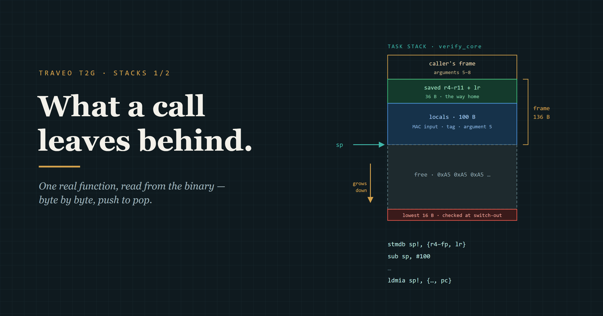
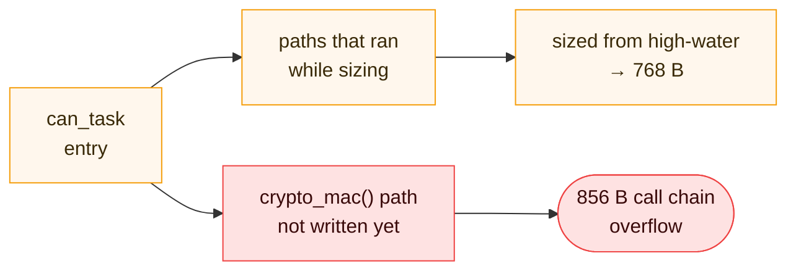
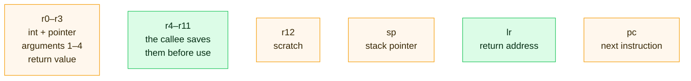
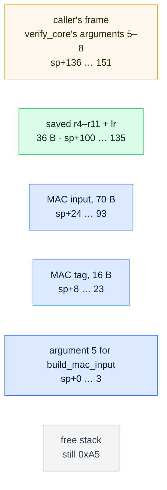
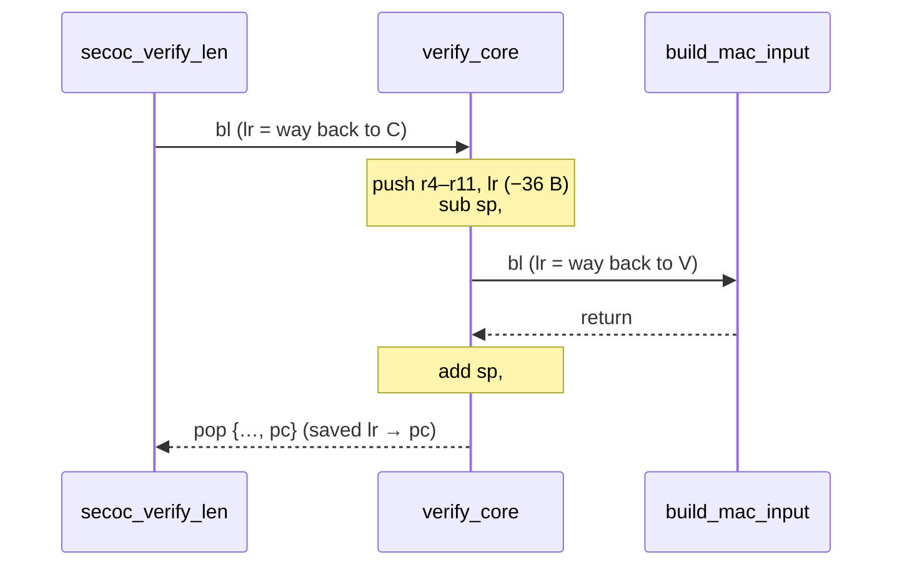
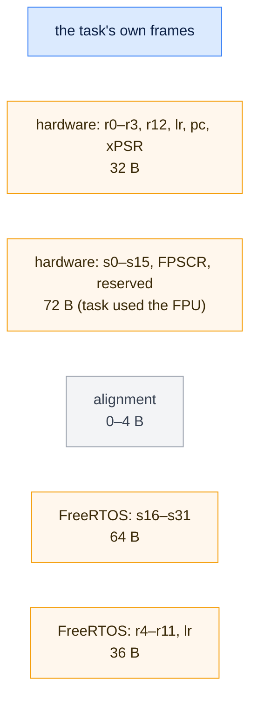
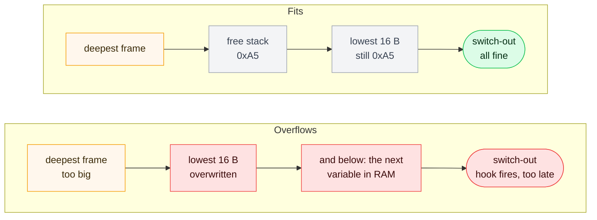

# Stacks 1/2 — What a function leaves on the stack

*Part VI of Traveo II Domain — building an automotive body-domain network from scratch on an Infineon TRAVEO™ T2G, with the design done in the open and Claude used as a visible collaborator.*



M5 ends its cost list with a confession: *"FreeRTOS caught the overflow on the first run, and the stacks went from 768 B to 1.5 KB."* I doubled the number and moved on.

M5 fixed the number. This post looks at the **bytes** behind it: what one real function from this project puts on its stack, line by line, from the compiled binary.

Two posts. This one is the basics, built on a single function that checks a CAN frame's MAC. The twist is one instruction in it, `blx`, that hides 568 bytes from any tool that reads the code. The high-water mark sees them only once that path has run. Post 2 is about that.

<!-- M5 quote: docs/blogs/m5-secoc-blog-draft.md "The cost". 568 B: crypto_mac push {r4, r5, lr} + sub.w sp, sp, #556, docs/bench/2026-11-14/stack_bound_asm_examples.md. -->

---

## 1. The problem

### Why wasn't the high-water mark enough?

In M2 I gave each task room for the CPU's context frame and planned to trim later from FreeRTOS's high-water mark. That number only knows the paths that **ran**.



*Node B, September. The red path didn't exist when the stack was sized. The first signed frame took it.*

<!-- M2: docs/briefs/M2-bringup_log.md §3. 768 B (192 words) / 856 B: docs/briefs/M5-bringup-plan.md row 14; commit 0cab23f (192 -> 384 words). Sized from a high-water mark before the path existed: ADR-0025 Table 1. "Call chain only": docs/future-ideas.md "Stack drill" (the prototype's limits: ISR/exception frames must be added by hand). 1064 = 856 + 208. -->

The 856 B came from a quick prototype that counted the call chain only, with no interrupt frame. Add the 208 B from §6 and it needs 1064 B. I doubled the stack to 1536 B. Post 2 shows why even that was nearly too small.

To know the worst case without running it, I first had to know what a function actually puts on the stack.

---

## 2. The registers a call uses

Arm's calling convention (the AAPCS) decides who keeps what. A function call on a Cortex-M uses these registers:



*Green is what a function may have to push onto the stack: `r4–r11` and `lr`.*

<!-- Float ABI: node_b_actuator/proj_cm7/Makefile VFP_SELECT=hardfp, build ninja -mfloat-abi=hard, readelf -A "Tag_ABI_VFP_args: VFP registers"; node_a_gateway/app Makefile VFP_SELECT= (default), ninja -mfloat-abi=softfp. docs/bench/2026-11-14/stack_bound_asm_examples.md "Float ABI". -->

- Integer and pointer arguments 1–4 travel in `r0–r3`; a 64-bit value takes a pair. The rest go **on the stack**.
- Floats depend on the build's float ABI. Node B builds hard-float, so float arguments go in `s0–s15`. Node A builds `softfp` and passes them in `r0–r3` like integers.
- A function may use `r4–r11` only if it saves them first and puts them back before returning.
- `lr` holds the return address. It's a register, not a stack slot, until the function calls someone else.

---

## 3. One real function, line by line

`verify_core` checks the MAC of a received CAN frame. It takes **8 arguments**, has two buffers on the stack, and calls four functions. Here it is on Node B (Cortex-M7), from `objdump`:

```
1008687a  stmdb   sp!, {r4, r5, r6, r7, r8, r9, sl, fp, lr}   ← push 9 registers = 36 B
1008687e  sub     sp, #100                                     ← room for locals: frame = 136 B
10086880  mov     r7, r0                                       ← keep argument 1 in a saved register
10086888  ldr     r6, [sp, #144]                               ← argument 7, read from the caller's frame
1008689e  bl      100867c4 <build_mac_input>                   ← call: lr = 0x100868a3
   …
100868f0  add     sp, #100                                     ← drop the locals
100868f2  ldmia.w sp!, {r4, r5, r6, r7, r8, r9, sl, fp, pc}   ← pop: the saved lr lands in pc = return
```

<!-- docs/bench/2026-11-14/stack_bound_asm_examples.md (Node B, built 2026-11-12, -Og). bl is 4 bytes, so the return address is 0x100868a2 | 1 (Thumb). -->

- `stmdb sp!` is a push. objdump calls `r10` `sl` and `r11` `fp`.
- **36 + 100 = 136 B.** GCC's own stack-usage file says the same: `verify_core 136`.
- After `bl`, `lr` is the next instruction's address with bit 0 set. Bit 0 means "Thumb code". Remember it for Post 2.
- The epilogue doesn't need a separate return. It pops the saved `lr` straight into `pc`.

A **leaf** function, one that calls nothing, can skip all of that:

```
100867ba  ldrb   r3, [r0, #0]
100867bc  ldrb   r0, [r0, #1]
100867be  orr.w  r0, r3, r0, lsl #8     ← result in r0
100867c2  bx     lr                     ← return: lr was never touched
```

*`get_u16le`: frame 0 B. Nothing pushed, nothing reserved.*

Honest — every listing here is a `-Og` debug build. Optimised builds have different frames.

---

## 4. The frame, as a picture

Where do the 136 bytes go? The stack grows **down**, so the newest frame is at the bottom.



*`sp` points at the bottom box's top edge. 100 B of locals: the three blue boxes plus 10 B spare.*

<!-- Offsets from the verify_core listing: add.w sl, sp, #24 (MAC input) · add r3, sp, #8 (tag) · str.w sl, [sp] (arg 5) · ldr [sp, #136..148] (args 5–8). 70 B = SECOC_DATAID_LEN 2 + SECOC_FRESHNESS_LEN 4 + SECOC_MAX_PDU 64; tag = SECOC_FULL_TAG_LEN 16. -->

Three kinds of thing live in a frame:
- **saved registers**, including the return address
- **locals**: here, two buffers for the MAC
- **arguments** for the next call, when there are more than four

---

## 5. Why must a caller save `lr`?

`bl` writes the return address into `lr`. There's only one `lr`. So the moment `verify_core` calls `build_mac_input`, its own way home is overwritten, unless it saved it first.



*The push at the start is what lets the function call anyone else. A leaf never needs it.*

So the depth of a call chain is simple: each function adds its own frame, and the deepest chain wins. Post 2 walks every chain that way.

---

## 6. What an interrupt pushes

FreeRTOS tasks run on the **process stack** (PSP); interrupts and `main()` use the **main stack** (MSP). When the scheduler switches a task out, the task's registers go onto **its own** stack.



*Up to 208 B on every task stack, on top of its deepest call chain. 72 B for a task that never touches the FPU.*

<!-- ADR-0025 D2 (ARMv7-M ARM B1.5.7 + FreeRTOS GCC port.c). Hardware frame 8 words / 26 with FP: also docs/briefs/M2-bringup_log.md §3. -->

The hardware pushes the first part by itself. FreeRTOS's switch handler pushes the rest. Here it is on Node A:

```
10041690  mrs       r0, PSP                                       ← the task's stack pointer
1004169c  tst.w     lr, #16                                       ← lr = EXC_RETURN: did the task use the FPU?
100416a2  vstmdbeq  r0!, {s16-s31}                                ← yes: save 16 FP registers, 64 B
100416a6  stmdb     r0!, {r4, r5, r6, r7, r8, r9, sl, fp, lr}     ← always: r4–r11 + EXC_RETURN, 36 B
100416c0  bl        1004279c <vTaskSwitchContext>                 ← pick the next task
```

<!-- docs/bench/2026-11-14/stack_bound_asm_examples.md, "PendSV_Handler" (Node A, built 2026-11-12). The only vstmdb/vpush in Node A's image. -->

Inside an interrupt, `lr` doesn't hold an address. It holds **EXC_RETURN**, a code that tells the core how to return: which stack, and whether an FP frame was saved. That's what `tst.w lr, #16` reads.

### What does an overflow look like?

FreeRTOS fills every new stack with `0xA5`. Both nodes use its overflow check "method 2": at each switch-out it looks at the **lowest 16 bytes**.



*The check runs after the damage. In M5 the hook fired, and its endless loop then let the watchdog reset the chip.*

<!-- configCHECK_FOR_STACK_OVERFLOW 2 on both nodes; stack_macros.h lines 92–97; tskSTACK_FILL_BYTE 0xa5 (docs/bench/2026-11-14/stack_bound_asm_examples.md, last section). M5: docs/briefs/M5-bringup-plan.md row 14. -->

---

## 7. The whole call, as pseudo code

Everything above, one step at a time, with `sp` tracked:

```
# caller
r0..r3 = cy, can_id, frame, plen             # arguments 1–4 in registers
[sp..] = epoch, counter, pdu_out, pdu_len    # arguments 5–8 on the stack
bl verify_core                               # lr = way back, pc = verify_core

# verify_core
push {r4..r11, lr}                           # sp -= 36   saved registers + return address
sp -= 100                                    # locals: MAC input, tag, outgoing argument
r6 = [sp + 144]                              # argument 7, from the caller's frame
bl build_mac_input                           # overwrites lr: that's why it was saved
blx oracle->mac                              # target from a register (Post 2)
sp += 100                                    # locals gone
pop {r4..r11, pc}                            # sp += 36   saved lr -> pc = return
```

And how FreeRTOS sees it:

```
create(task):
    fill task.stack with 0xA5                 # every byte, once

switch_out(task):
    push the context (up to 208 B) onto task.stack
    if any of task.stack[0..15] != 0xA5:      # the lowest 16 bytes
        vApplicationStackOverflowHook(task)   # after the damage, not before

high_water(task):
    return count of 0xA5 bytes from the bottom up   # only paths that ran
```

The overflow itself is one line of arithmetic:

```
overflow  if  top_of_stack − (deepest chain + 208 B)  <  bottom_of_stack
```

Honest — the pseudo code is an illustration, not a capture. In the real code the caller reserves the space for arguments 5–8 inside its own frame.

---

## 8. User manual — read your own frames

Disassemble one function from your build:

```
arm-none-eabi-objdump -d --no-show-raw-insn build/app.elf --disassemble=verify_core
```

Then add `-fstack-usage` to your compiler flags: GCC writes one `.su` file per source file, one line per function.

What to look for, with this function as the example:

```
1008687a  stmdb   sp!, {r4, …, fp, lr}      ← saved registers: count them × 4
1008687e  sub     sp, #100                  ← locals
1008689e  bl      100867c4 <build_mac_input> ← a direct call: the target is in the instruction
100868b0  blx     fp                         ← an indirect call: the target is in a register
secoc.c:126:30:verify_core	136	static      ← the .su line: 36 + 100, the compiler agrees
```

<!-- Listing lines: docs/bench/2026-11-14/stack_bound_asm_examples.md (register list shortened with "…"). .su line: node_b_actuator/proj_cm7/build, path prefix shortened. -->

The demo: add a used local `uint8_t scratch[256];` to any function and rebuild. The `sub sp` should grow by about 256, and so should its `.su` line. Then look for the `blx` lines in your own image. Each one is a call whose target no tool can read from the code.

That's exactly what blew up my CAN task: `crypto_mac` opens with `push {r4, r5, lr}` and `sub.w sp, sp, #556`, a 568 B frame, reached only through `blx`. Post 2 is how I made sure it can't happen quietly again.

---

## Metadata

```
Board      · Node A: TRAVEO™ T2G Body Entry (CYT2B7, Cortex-M4F) · Node B: KIT_T2G-B-H_LITE (CYT4BF, Cortex-M7)
Toolchain  · ModusToolbox, GCC 14.2.1 (-Og), arm-none-eabi-objdump
RTOS       · FreeRTOS (stack overflow check, method 2)
Repo       · main
Written    · November 2026
```

## Follow along

💻 GitHub — Traveo II Body Domain

🔗 https://github.com/binhnguyenthanh051-ops/traveo-body-domain (main)

💻 LinkedIn

🔗 https://www.linkedin.com/in/binh-nguyen-thanh-2b807714b/

---

## Figures list
- `img/stack-1/hero.png` (from `hero.svg`, caption `TRAVEO T2G · STACKS 1/2`) and `img/stack-1/fig-01…06.png`, rendered by `host_tools/blog/render_diagrams.py`.
- Medium tags: Embedded Systems, ARM, Microcontrollers, FreeRTOS, Automotive.
