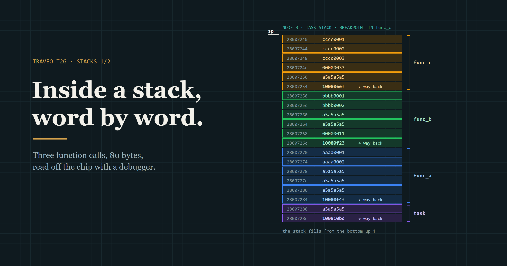
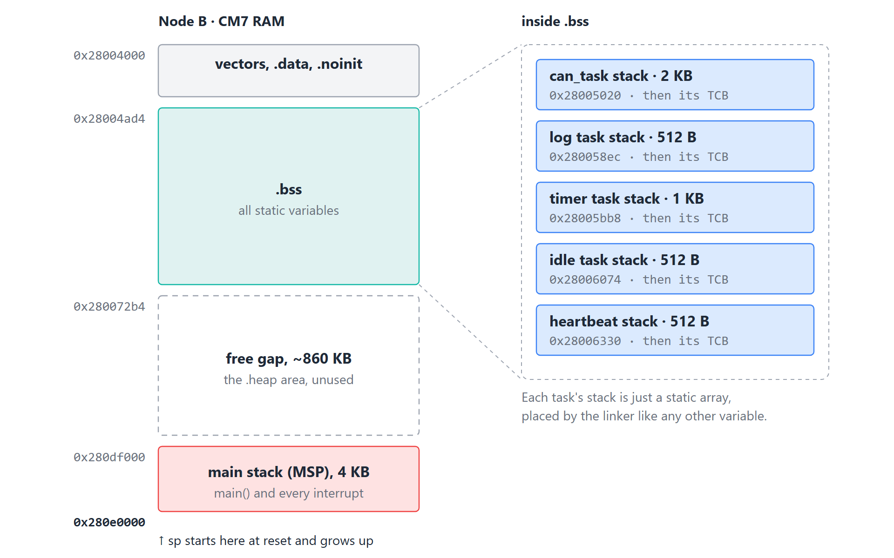
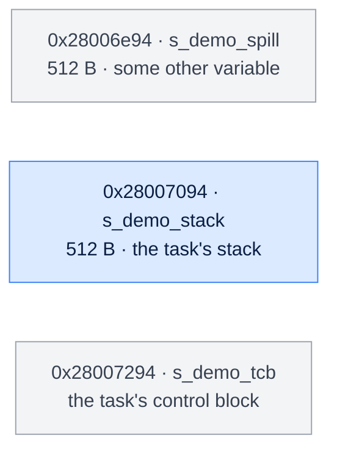
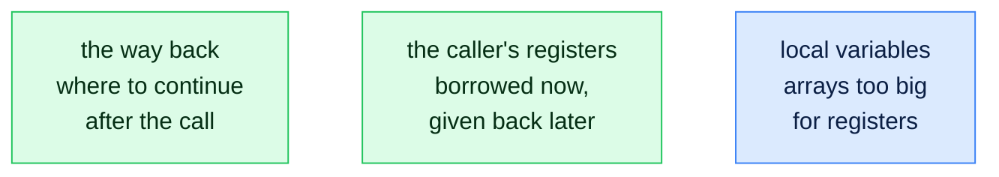
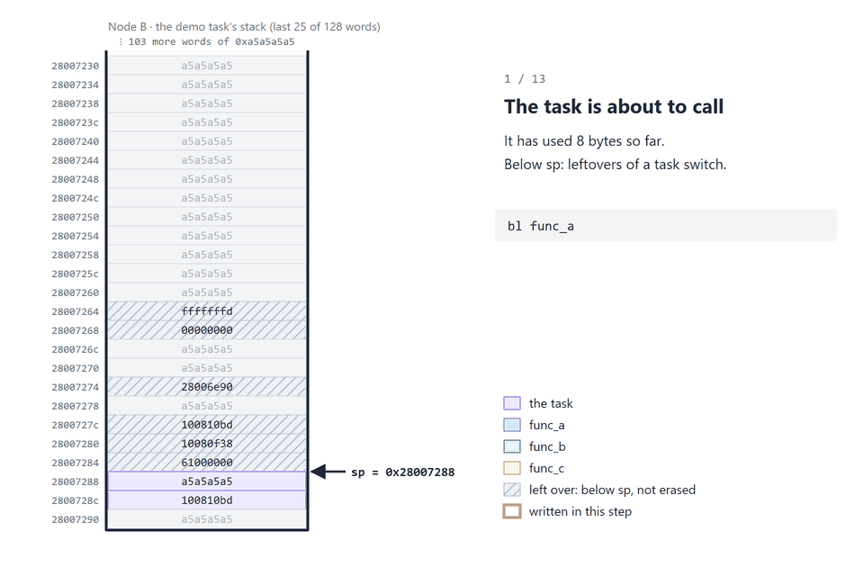
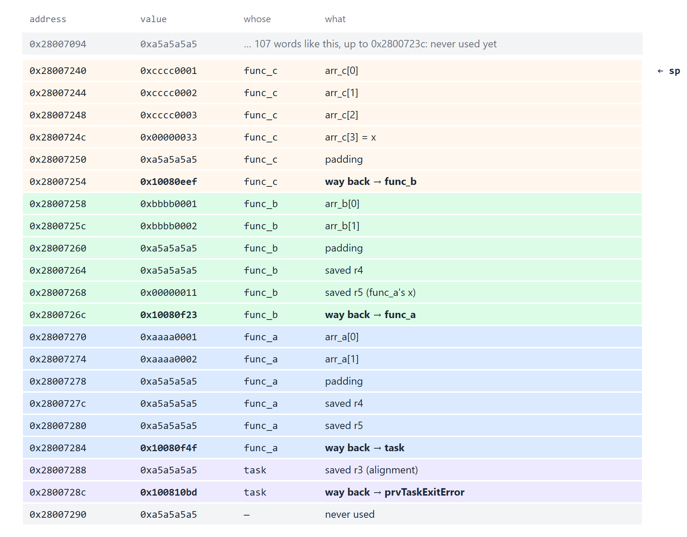
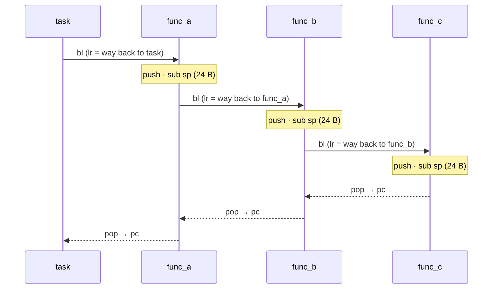
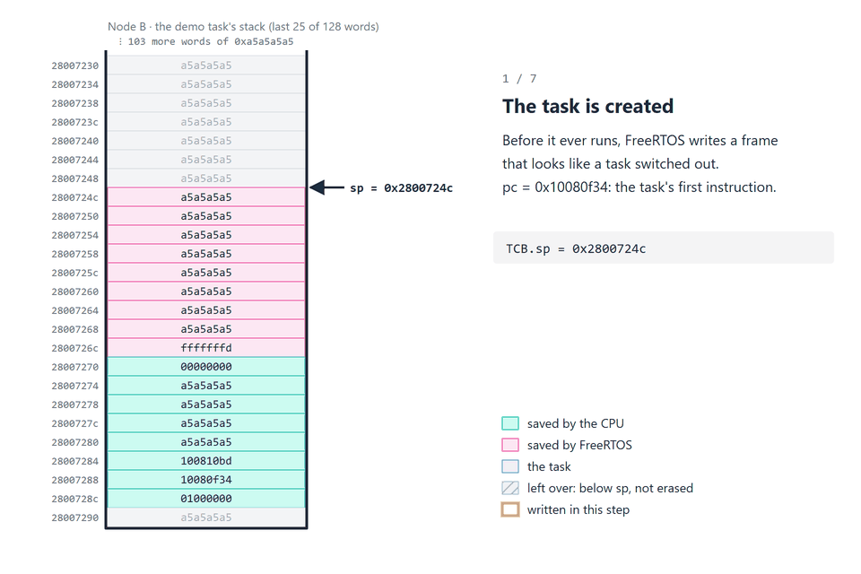
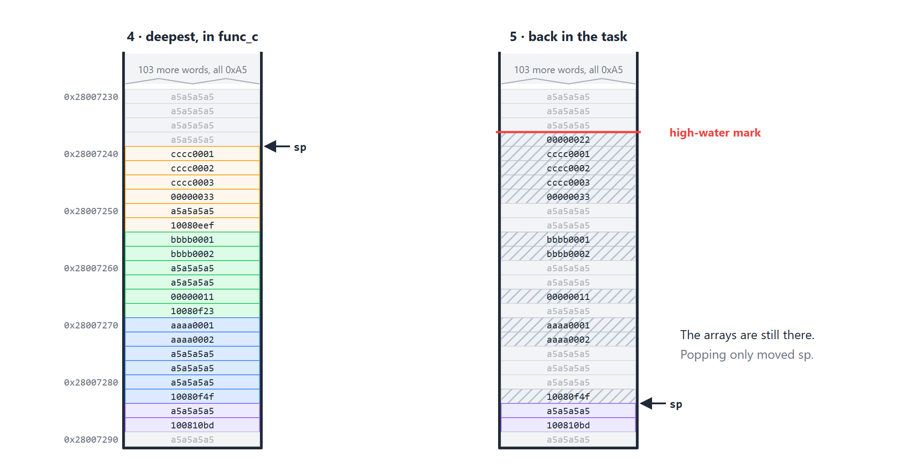
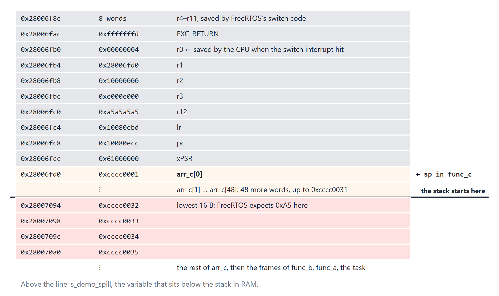

# Stacks 1/2 — What happens on the stack when a function calls another

*Part VI of Traveo II Domain — building an automotive body-domain network from scratch on an Infineon TRAVEO™ T2G, with the design done in the open and Claude used as a visible collaborator.*



M5 ends its cost list with a confession: *"FreeRTOS caught the overflow on the first run, and the stacks went from 768 B to 1.5 KB."* I doubled the number and moved on.

Doubling a number is easy. Knowing what fills it is not. So this time I stopped the chip in the middle of three function calls and read the stack out, word by word.

This post is the basics, with real bytes from a real board. Post 2 is about the calls you can't see coming.

<!-- M5 quote: docs/blogs/m5-secoc-blog-draft.md "The cost". Everything below: docs/bench/2026-11-16/stack_demo.md and the GDB logs next to it (Node B, demo image STACK_DEMO=1/2, built 2026-11-16, -Og). -->

---

## 1. What is a stack?

**A stack is the memory that gives every call still running its own private space: its way back, the registers it borrows, its local variables. That space is handed back in reverse order as the calls return.** One CPU register, `sp` (the stack pointer), marks how far it is filled.

A bare-metal program has one stack. With FreeRTOS, every task gets its own, so a task can be paused and resumed without stepping on another's calls. Interrupts use a separate one, the main stack.

Here is where all of them live on Node B:



*Not to scale. Five task stacks sit among the static variables. The main stack sits alone at the top of RAM.*

<!-- Normal image (sha256 10b2b3d0577f), actuator_cm7.map lines 9706–10019 and the vector table: docs/bench/2026-11-16/stack_demo.md "Where every stack is". Drawn by host_tools/blog/stack_demo_figs.py (fig_ram_map). -->

The linker's map file says the same, line by line:

```
.bss.s_stack        0x28005020   0x800   can_task.o   ← the CAN task's stack
.bss.s_tcb          0x28005820    0xbc   can_task.o   ← its TCB, right after it
.bss.s_log_stack    0x280058ec   0x200   log_task.o
.bss.s_timer_stack  0x28005bb8   0x400   main.o       ← FreeRTOS's own timer task
.bss.s_idle_stack   0x28006074   0x200   main.o       ← and its idle task
.bss.s_hb_stack     0x28006330   0x200   main.o
__StackTop   = 0x280e0000                             ← the main stack: no variable,
__StackLimit = 0x280df000                               just two linker symbols
```

<!-- actuator_cm7.map lines 9829, 9830, 9843, 9858, 9862, 9866, 10018, 10019 (file paths shortened). -->

A task's stack is an ordinary variable. Nothing marks it as a stack. The main stack isn't a variable at all: it's the last 4 KB of RAM, and the CPU loads its top address from the vector table at reset.

Not every RTOS forces this. An AUTOSAR OS, for example, can let tasks share one stack when the configuration guarantees they never wait mid-run. A task that preempts another must then finish first, so it stacks up just like a function call. Tasks that can wait, or that must be kept apart, get stacks of their own. A FreeRTOS task can always block in the middle of a call, so FreeRTOS gives every task its own.

For this post I added one more task, with a small stack of its own:

```c
static StackType_t s_demo_stack[128];   // 128 words × 4 bytes = 512 bytes
```

The linker put it here in Node B's RAM:



*Lowest address at the top, the way a debugger's memory window lists it. The stack is the blue one.*

<!-- arm-none-eabi-nm -n on the demo ELF (sha256 1a73feae1205); GDB "print &s_demo_stack" etc. in stack_demo_capture.txt. -->

Two things are worth knowing up front:
- The stack fills from the **end** of the array (the high address) towards the start. In the pictures below, it fills from the bottom up, like water in a tank.
- Before the task runs, FreeRTOS paints every byte with `0xA5`. Any word that still reads `0xa5a5a5a5` has never been used.

---

## 2. Why does a function need the stack?

When a function calls another one, it has to park a few things somewhere safe until the call comes back:



*One function's slice of the stack is called its frame. It holds these three things.*

Small arguments don't need the stack at all. The first four travel in CPU registers (`r0` to `r3`).

---

## 3. The example

Three functions, each with a small array of values that are easy to spot in a hex dump:

```c
void func_c(uint32_t x) {
    uint32_t arr_c[4] = {0xCCCC0001, 0xCCCC0002, 0xCCCC0003, x};
    stack_demo_mark(4, arr_c, 4);          // breakpoint here: the deepest point
}
void func_b(uint32_t x) {
    uint32_t arr_b[2] = {0xBBBB0001, 0xBBBB0002};
    func_c(x + 0x11);
}
void func_a(uint32_t x) {
    uint32_t arr_a[2] = {0xAAAA0001, 0xAAAA0002};
    func_b(x + 0x11);
}
// the task calls func_a(0x11)
```

<!-- Shortened from node_b_actuator/proj_cm7/src/stack_demo.c: each function also calls stack_demo_mark() (the breakpoint) and stack_demo_keep() (keeps the array alive). -->

`stack_demo_mark()` does nothing useful. It's just a place to put a breakpoint. I ran this on Node B as its own small task, stopped it with GDB at each step, and dumped all 512 bytes of its stack every time.

---

## 4. Watch it fill up

Here is the whole run, one instruction at a time. Every value comes from the chip:



*Three calls in, three returns out. Yellow marks the words written in that step.*

<!-- stack-calls.gif is drawn by host_tools/blog/stack_demo_gif.py from stack_demo_capture.txt. Frames 1, 4, 7, 10 and 13 are the step 1–5 dumps; the frames in between replay what the disassembly says each instruction writes, and the script checks each replay against the next dump, word for word. sp: 0x28007288, 0x28007270, 0x28007258, 0x28007240. -->

- **At the start:** the task itself uses only 8 bytes. Its one important word is `100810bd`, the "way back" FreeRTOS gave it.
- **Each call** takes two steps: `push` saves the way back, then `sub sp` makes room for the array. Here each call happens to take 24 bytes. A bigger array, or more registers to save, makes a bigger frame.
- **Before any call,** the striped words under `sp` are leftovers of a task switch. Section 6 shows where they come from.

At the deepest point, inside `func_c`, here is every word, with whose it is:



*80 bytes in use at the deepest point. The 428 bytes above them were never touched.*

<!-- stack-window.png: step 4 of stack_demo_capture.txt; "whose/what" from the disassembly, docs/bench/2026-11-16/stack_demo.md "Check 1". 428 B = 107 words × 4. -->

Read it from the bottom up and it tells the whole story:
- Each frame ends with **"way back"**: the address to return to. `0x10080f4f` is inside the task, `0x10080f23` inside `func_a`, `0x10080eef` inside `func_b`. A debugger's call stack window is built from exactly these words.
- `func_b` saved `0x00000011` for `func_a`. That's `func_a`'s `x`, kept in a register that `func_b` wanted to borrow.
- Some words are just padding. The compiler keeps `sp` a multiple of 8, so a frame is rounded up.
- The odd last digit in every way-back address isn't a typo. Bit 0 set means "Thumb code" on this CPU. The real address is one less.

Honest — this is a debug build (`-Og`). An optimised build can keep small arrays in registers, and the frames come out different.

---

## 5. Push and pop

How does a frame get there? Two instructions on the way in, two on the way out. This is `func_b`, from the same image:

```
10080ecc  push  {r4, r5, lr}         ← save 3 registers, including lr (the way back): 12 B
10080ece  sub   sp, #12              ← make room for arr_b + padding: 12 B more
   …
10080eea  bl    func_c               ← call: lr = 0x10080eef
   …
10080ef6  add   sp, #12              ← give the room back
10080ef8  pop   {r4, r5, pc}         ← restore, and jump back through the saved lr
```

<!-- arm-none-eabi-objdump -d of the demo ELF (sha256 1a73feae1205), func_b. lr after bl = 0x10080eee | 1 = 0x10080eef, the value seen at 0x28007254 in the capture. -->

`bl` puts the way back in a register called `lr`. There is only one `lr`, so before `func_b` calls `func_c`, it must save its own way back first. That's what the `push` is for:



*Every `push` on the way in has a `pop` on the way out. Each frame is 24 bytes here.*

---

## 6. What happens at a task switch?

A task doesn't own the CPU. Many times a second, the scheduler pauses it and runs another task. The paused task's registers have to go somewhere, and they go onto its own stack:



*From the task's creation to its first switch-out and back in. Every value is from the chip.*

<!-- stack-switch.gif, host_tools/blog/stack_demo_gif.py: frame 1 = the dump in gdb_try1_console.txt (the stack as xTaskCreateStatic left it, before the task ran: pc 0x10080f34 = stack_demo_task, lr 0x100810bd = prvTaskExitError, xPSR 0x01000000); frame 6 = the "before the chain runs" dump of stack_demo_capture.txt (a real switch-out frame: pc 0x10080f38 in the wait loop, EXC_RETURN 0xfffffffd), checked word for word; frame 7 = step 1. 68 B = 8 + 9 words. 208 B with the FPU: ADR-0025 D2. -->

1. **Created:** FreeRTOS writes a fake "switched-out" frame before the task ever runs. Starting a task is then the same as resuming one.
2. **Switched out:** the CPU saves 8 registers by itself. One of them is `pc`, the exact place the task stopped.
3. FreeRTOS's switch code saves 9 more, then writes `sp` into the task's control block (TCB).
4. **Switched back in:** it reads `sp` from the TCB and pops everything again.

Only the registers go on the stack. The rest of the task's info (its name, its priority, that saved `sp`) lives in the TCB, the block right next to the stack in the first figure.

So a task's stack needs room for its deepest call chain **plus** one of these switch frames: 68 bytes here, and up to 208 if the task uses the floating-point unit.

---

## 7. Coming back: the stain

After all three functions return, `sp` is back where it started. But look at the memory:



*Right: back in the task. The arrays are still there. Popping only moved `sp`.*

<!-- Step 5 of stack_demo_capture.txt. Three words changed after step 4, each by a later push into the popped area (stack_demo.md "Check 1", step 5). Deepest non-0xA5 word 0x2800723c; 0x2800723c − 0x28007094 = 424 B still 0xA5. -->

Nothing gets erased. The old values stay until something else writes over them. A few words did change after the return, and each one came from a later `push`, so they're new values, not leftovers.

That's where FreeRTOS's **high-water mark** comes from. It counts how many bytes at the far end are still `0xA5`. Here that's 424 bytes, the part above the red line. Like a stain on a wall, it shows how high the water once came.

Honest — the mark only knows the paths that ran. If one rare call goes deeper, and it never ran while I watched, the mark has no idea. That's what Post 2 is about.

---

## 8. What happens when it doesn't fit?

To see it, I built a second version where `func_c`'s array is 640 bytes, bigger than the whole 512-byte stack. Here is the memory where the stack begins:



*`sp` ended up 196 bytes below the stack, inside another variable.*

<!-- docs/bench/2026-11-16/stack_demo_overflow.txt: func_c sub.w sp, sp, #644; stop 1 sp = 0x28006fd0 = 0x28007094 − 196; stop 2 = vApplicationStackOverflowHook from vTaskSwitchContext (tasks.c:3132) from PendSV_Handler. Lowest word written 0x28006f8c: 0x28007094 − 0x28006f8c = 264 B of s_demo_spill overwritten. -->

Nothing stopped the CPU from writing there. The array, and then the saved registers, landed in `s_demo_spill`, the variable below the stack: 264 bytes of it.

FreeRTOS only noticed at the next task switch. It checks that the stack's lowest 16 bytes are still `0xA5`. They weren't, so it called its overflow hook. GDB caught the hook, called from the task-switch code, with the task's name: `"stackdemo"`.

So the check works, but it comes **after** the damage. On a real task, that other variable could be a CAN queue.

---

## 9. User manual — see it on your own board

Build the demo into the image (it's off by default), flash it, then start a GDB server that attaches without resetting the chip:

```
bash ./zz_build_actuator_app.sh program all STACK_DEMO=1
bash ./tools/bench/gdbserver_node.sh B
arm-none-eabi-gdb -batch -x tools/bench/stack_demo_capture.gdb actuator_cm7.elf
```

The script sets the breakpoint, lets the task run, and dumps the stack at each step. What success looks like: at step 4, `bt` shows the whole chain (shortened):

```
#0  stack_demo_mark (step=4, arr=0x28007240, n=4)      ← the breakpoint
#1  0x10080ec0 in func_c (x=51)                          ← 0x33
#2  0x10080eee in func_b (x=34)                          ← 0x22
#3  0x10080f22 in func_a (x=17)                          ← 0x11
#4  0x10080f4e in stack_demo_task (…)                    ← the task
```

<!-- stack_demo_capture.txt lines 185–189, path and "@entry" parts removed. -->

To dump the stack yourself at any stop: `x/128wx &s_demo_stack`.

The failure demo: build with `STACK_DEMO=2` and run `stack_demo_overflow.gdb` instead. It should stop in the overflow hook:

```
#0  vApplicationStackOverflowHook (…, pcTaskName="stackdemo")
#1  vTaskSwitchContext () at tasks.c:3132
#2  PendSV_Handler () at port.c:473
```

<!-- stack_demo_overflow.txt lines 103–105, shortened. -->

Then flash the normal image back with `program all`. The demo exists only in these two bench builds.

### Where to read more

Three free Arm documents cover everything in this post. Search the ID on developer.arm.com. Both Cortex-M4 and Cortex-M7 are Armv7-M, so the same manuals apply to either.

- **Cortex-M7 Devices Generic User Guide** (DUI 0646), or the Cortex-M4 one (DUI 0553). Start here: chapter 2, *Programmers model*, explains `r0` to `pc`, the main stack and the process stack in plain words.
- **Procedure Call Standard for the Arm Architecture**, the "AAPCS" (IHI 0042). The calling rules: `r0`–`r3` carry arguments, `r4`–`r11` must be saved by the function that uses them, `sp` stays 8-aligned, and the stack grows down. Read *Core registers* and *The stack*.
- **Armv7-M Architecture Reference Manual** (DDI 0403). The final word: what each instruction does (`push`, `sub sp`, `bl`), the Thumb bit, and what the CPU pushes on an interrupt (*Exception entry behavior*, and *Exception return behavior* for `EXC_RETURN`).

<!-- Doc IDs: Arm's public document numbers. Sections cited by title, not number, so they survive new manual revisions. -->

---

## Metadata

```
Board      · Node B: KIT_T2G-B-H_LITE (TRAVEO™ T2G Body High, CYT4BF, Cortex-M7)
Toolchain  · ModusToolbox, GCC 14.2.1 (-Og), arm-none-eabi-gdb, OpenOCD
RTOS       · FreeRTOS 10.6.2 (stack overflow check, method 2)
Evidence   · GDB dumps on silicon, 2026-11-16
Repo       · main
Written    · November 2026
```

## Follow along

💻 GitHub — Traveo II Body Domain

🔗 https://github.com/binhnguyenthanh051-ops/traveo-body-domain (main)

💻 LinkedIn

🔗 https://www.linkedin.com/in/binh-nguyen-thanh-2b807714b/

---

## Figures list
- `img/stack-1/hero.png` and `stack-ram-map/stack-window/stack-stain/stack-overflow.png`: drawn by `host_tools/blog/stack_demo_figs.py` straight from the GDB logs in `docs/bench/2026-11-16/`, rendered by `render_diagrams.py shoot`. `stack-calls.gif`, `stack-switch.gif`: `host_tools/blog/stack_demo_gif.py` (needs Pillow).
- `img/stack-1/fig-01…03.png`: the Mermaid blocks, rendered by `host_tools/blog/render_diagrams.py`.
- Medium tags: Embedded Systems, ARM, Microcontrollers, FreeRTOS, Automotive.
