# Stacks 2/2 — The CAN task that outgrew its stack, and the tool I built so it can't happen quietly again

*Part VII of Traveo II Domain — building an automotive body-domain network from scratch on an Infineon TRAVEO™ T2G, with the design done in the open and Claude used as a visible collaborator.*

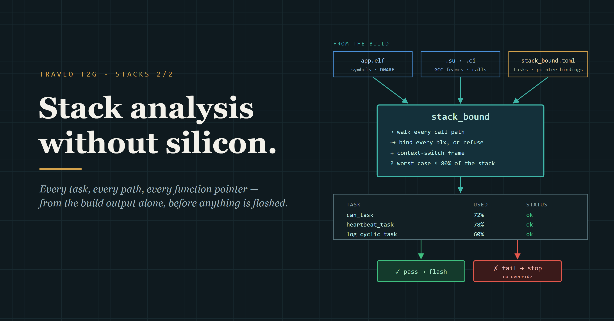

Post 1 ends with a promise: *"Post 2 is how I made sure it can't happen quietly again."* This post keeps it.

Post 1 reads **one** function's frame. Post 2 adds frames up along **every path of every task**, at build time, and stops the build when a stack is too small.

The plan: the incident, the function pointer that hid it, the concept, the design, the implementation, and the test. The test has a twist: the stack I had doubled after the incident had **48 bytes** left on its worst path.

<!-- Post 1 last line: docs/blogs/stack-1-blog-draft.md §8. 48 B = 1536 − 1488 (Node A can_task: docs/bench/2026-11-11/stack_bound_nodeA_app.txt; old stack 384 w, docs/project/findings.md F-021). -->

---

## 1. The incident

In the M5 bring-up, Node B's CAN task verified its first signed frame and overflowed. FreeRTOS's overflow hook fired. The hook's endless loop then tripped the hardware watchdog, and the chip reset.

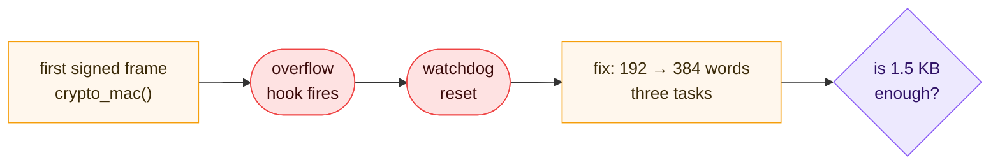

*I doubled three stacks. Nothing told me whether that was enough.*

<!-- docs/briefs/M5-bringup-plan.md row 14 (Node B can; Node A can + app had the same 192 words) and commit 0cab23f. -->

A 30-line prototype added up frames along the calls and found **856 B** of call chain (no interrupt frame) against a **768 B** stack, in seconds, with no debugger. It proved the idea. Its one big gap: calls through function pointers had to be added by hand.

The code kept growing after that fix. In November a crypto-error log was added below the MAC, 160 B deeper than anything the prototype saw. So the same task has several numbers in this post. Each one is labelled:

```
Sep 28  Node B  prototype            856 B   call chain only
Nov 6   Node B  GCC's graph alone    552 B   call chain, stops at the pointer
Nov 6   Node B  pointer followed    1256 B   call chain, error log included
Nov 11  Node B  stack_bound         1264 B   + 208 B switch frame = 1472 B
Nov 11  Node A  stack_bound         1280 B   + 208 B switch frame = 1488 B
```

The 8 B between Nov 6 and Nov 11 is `memcpy`, which comes prebuilt with no frame file: the quick count missed it, the tool asked for it.

<!-- 856: docs/briefs/M5-bringup-plan.md row 14 + docs/future-ideas.md (Sep 28 = idea date, W40 Stage 3). Error log: F-018, commit b17c7f5 (2026-11-06); 160 B below crypto_mac: docs/project/findings.md F-021. 552 / 1256: ADR-0025 Table 5; "missed memcpy (8 B)": ADR-0025 D4 under Table 4. 1264 / 1280 + 208: docs/bench/2026-11-11/stack_bound_node*.txt. -->

<!-- docs/future-ideas.md "Stack drill". -->

---

## 2. The call nobody can see

### Why did the compiler's own graph miss it?

GCC can write every function's frame and its call graph. Adding them up for the CAN task gave **552 B**. With the pointer followed, the same call chain was **1256 B**.

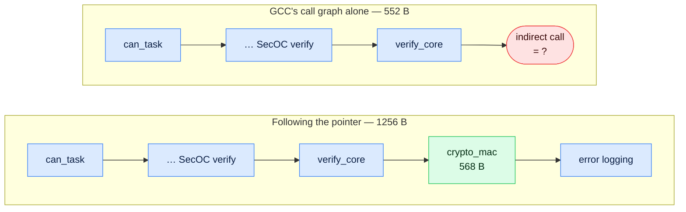

*Node B, Nov 6, call chain only. The deepest frame sits behind a function pointer; the compiler marks the call and stops.*

<!-- 552 B vs 1256 B: ADR-0025 Table 5 (Node B spike, 2026-11-06). 568 B: docs/bench/2026-11-14/stack_bound_asm_examples.md. -->

The pointer is there on purpose. SecOC reaches the MAC through a small interface, so my PC tests plug in a fake MAC and the board plugs in the real one. Good for testing, invisible to a simple stack count.

### What does a function pointer look like in the binary?

In C, it's one line in `verify_core`:

```c
if (!cy->oracle->mac(cy->key_id, macin, macin_len, tag))
```

In the binary, the target isn't in the instruction. It's loaded into a register at run time:

```
10086880  mov    r7, r0          ← r7 = cy (argument 1)
100868a4  ldr    r3, [r7, #0]    ← r3 = cy->oracle
100868a6  ldr.w  fp, [r3]        ← fp = oracle->mac, the first slot
100868b0  blx    fp              ← call whatever address fp holds
```

And the address itself sits in a constant table in flash:

```
10087eb0  29 61 08 10            ← g_oracle = { crypto_mac }: 0x10086129
```

`0x10086129` is `crypto_mac` (`0x10086128`) **+ 1**: the Thumb bit from Post 1. Every function pointer on a Cortex-M carries it. That's how a tool can spot a stored function address in the image.

<!-- docs/bench/2026-11-14/stack_bound_asm_examples.md (Node B, built 2026-11-12): verify_core, g_oracle objdump -s, nm. Source line: shared/secoc/src/secoc.c:139; g_oracle: node_b_actuator/proj_cm7/src/secoc_app.c:27. -->

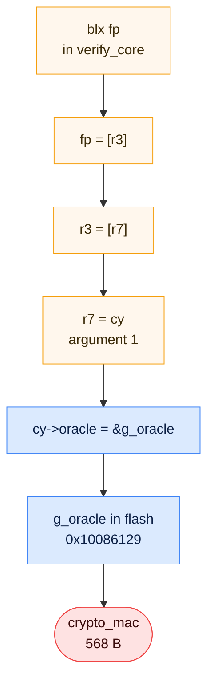

*Tracing the register back to the word in flash. The 568 B frame is at the end of that chain.*

---

## 3. The concept: walk every path, refuse to guess

A direct call (`bl`) carries its target. An indirect call (`blx`) needs a **binding**: a written answer to "what can this pointer hold?". The walk is short:

```
depth(f):
    if f has no known frame:      error "no frame"          # never 0 B
    if f is already on the path:  error "recursion"
    worst = 0
    for each call in f:
        if call is direct (bl):   targets = [the address in the instruction]
        else (blx rN):            targets = binding(call) or error "no binding"
        for t in targets:
            worst = max(worst, depth(t))
    return frame(f) + worst

required(task) = depth(task entry) + 208 B        # the switch frame from Post 1
pass if required ≤ 80% of the task's stack
```

Here it is on `verify_core`, Node B's Nov 12 build (call chain only, no switch frame):

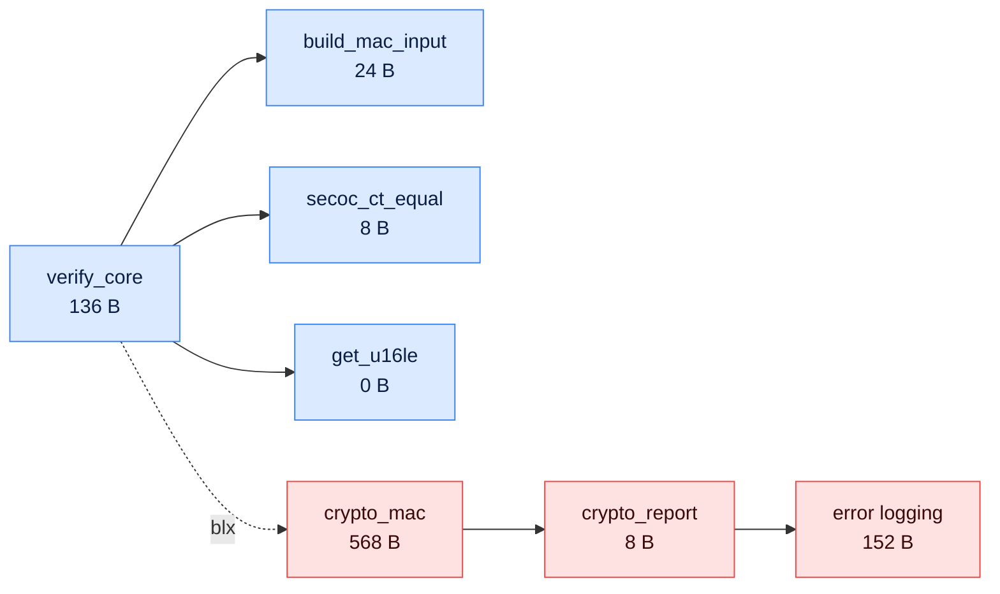

*The red branch is the deepest. It only exists if the pointer is followed.*

```
depth(error logging) = 80 + 40 + 24 + 8          = 152 B
depth(crypto_mac)    = 568 + 8 + 152             = 728 B
depth(verify_core)   = 136 + 728                 = 864 B
```

<!-- Frames: GCC .su (secoc.su: build_mac_input 24, secoc_ct_equal 8, get_u16le 0) and the worst path in docs/bench/2026-11-14/stack_bound_asm_examples.md (log_evt 80 → log_ring_put_locked 40 → log_ring_copy_in 24 → memcpy 8). -->

The rule above all others: **refuse to guess**. A wrong "pass" is worse than no answer. If the tool can't give a safe number, it gives **no number** and says why.

---

## 4. The design, and why

### Which source do I trust?

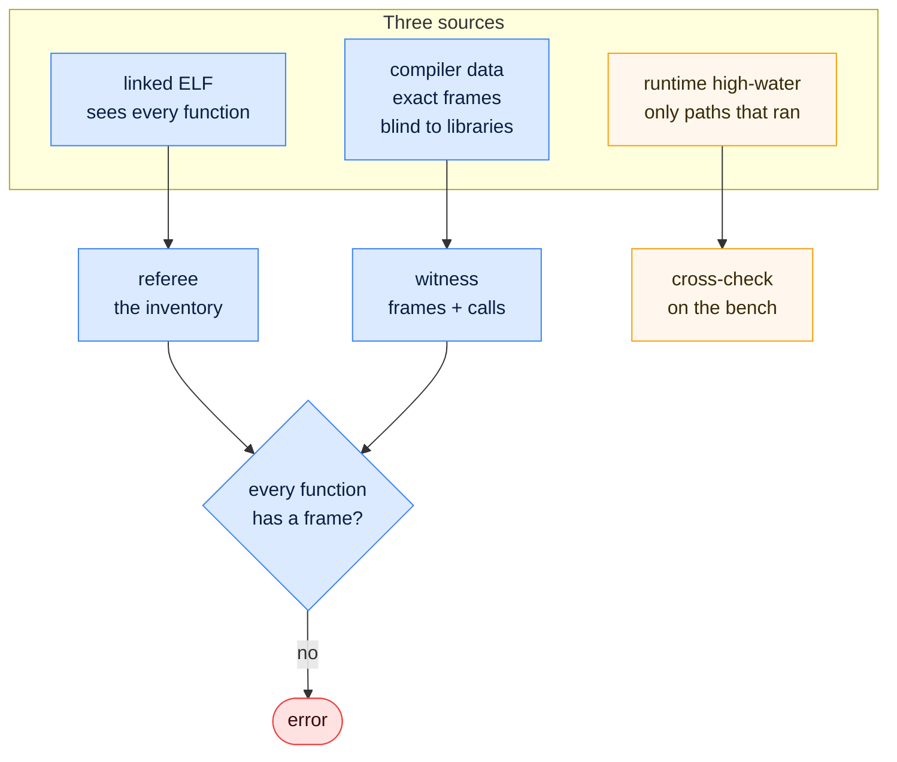

*The ELF decides what exists. The compiler gives the numbers. The bench checks the tool.*

- **Compiler data alone** misses prebuilt code. `memcpy` comes from the C library with no frame file; a script would count it as 0 B. Here it's a written 8 B, with its source.
- **Runtime alone** only sees what ran. It stays as the check on the tool: if the bench ever measures more than the static number, the tool is wrong.

### How are pointers bound?

The full design follows stored **values**: const tables in flash, initialised data, registration calls. Types only narrow the list, because a `void *` cast breaks a type search.

Honest — today the bindings are a list I write, and the tool checks each one against the binary. Following stored values automatically is the next slice.

### Why 80%?

The worst path must fit in **80%** of the stack. The 20% covers the next small change to an error path, the kind nobody runs on the bench. A fixed byte margin doesn't scale: 64 B is plenty on 512 B and nothing on 2 KB.

Nothing in the tool is about this project, so it lives in its own public repo, **stack_bound**, pinned here as a git submodule.

---

## 5. The implementation

### Five steps

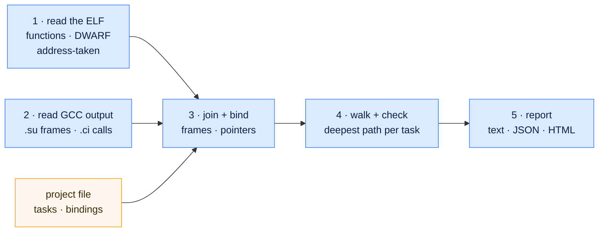

*About 1,000 lines of Python. It runs on the PC, after every firmware build.*

1. **The ELF.** Every function symbol becomes a function, keyed by address. DWARF adds where each one is declared. Any aligned word in the image that equals a function's start + 1 marks it **address-taken**.
2. **GCC's output.** Two flags write a frame file and a call-graph file per source file. The parsers are strict: a line they don't know, or a `dynamic` frame (a VLA or `alloca`), is an error.
3. **Join and bind.** Frames join on file, line, column and name, because two files can each have a `static` helper with the same name. Then each indirect call gets its binding.
4. **Walk and check.** The pseudo code from §3, with each function's result remembered.
5. **Report.** One model, rendered as text, JSON and an HTML page with no script, so it opens offline on a bench PC.

The real compiler lines behind `verify_core`:

```
secoc.c:126:30:verify_core	136	static
edge: { sourcename: "secoc.c:verify_core" targetname: "__indirect_call" label: "secoc.c:139:10" }
```

<!-- node_b_actuator/proj_cm7/build (2026-11-12 build), path prefixes shortened. -->

And the binding for that `__indirect_call`, with the reason the report prints:

```toml
[[indirect]]
function = "verify_core"
targets  = ["crypto_mac"]
reason   = "cy->oracle->mac: g_oracle = { crypto_mac } (secoc_app.c:27), the only secoc_mac_if_t in the image"
```

The tool checks the claim. If the call has no binding, or the target is never address-taken, it stops:

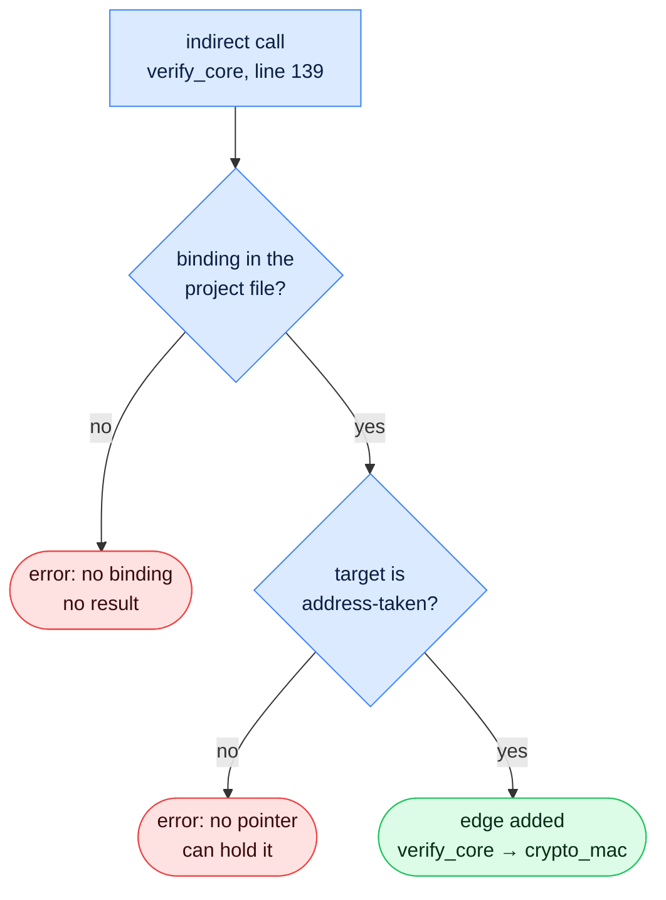

*Every pointer ends green or stops the build. There is no third way out.*

Each image binds **9** functions with indirect calls: the MAC, the flash store, the IPC port to the security core.

<!-- 9 [[indirect]] entries in both stack_bound.toml files. -->

```
Language     Python 3.11+, pyelftools
Input        unstripped ELF with -g, plus GCC -fstack-usage -fcallgraph-info=su
Exit codes   0 pass · 1 a stack fails · 2 no safe result · 3 usage error
Tests        47
Run time     1.6–2.5 s per image on my PC
```

<!-- 47: pytest on tools/stack_bound v0.2.0 (2026-11-14). Run time: docs/bench/2026-11-14/stack_bound_failure_demo.md §3. ~1,000 lines: wc -l tools/stack_bound/src = 1,057 incl. the profile. -->

### Where it runs

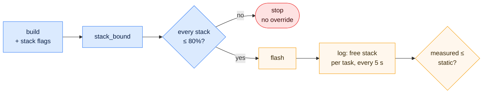

*Blue runs on the PC, amber on the board. The build checks the stacks; the bench checks the tool.*

The gate sits in the build scripts I flash with, so it can't be forgotten. There's no override: a failing stack is fixed or raised. The analysis flags stay in the build, because the code bytes are identical with and without them.

---

## 6. The test

### The first real image broke the tool

The test programs passed. Then I ran it on the real firmware, and the **tool** had bugs. A vendor SDK does things my small test programs never did.

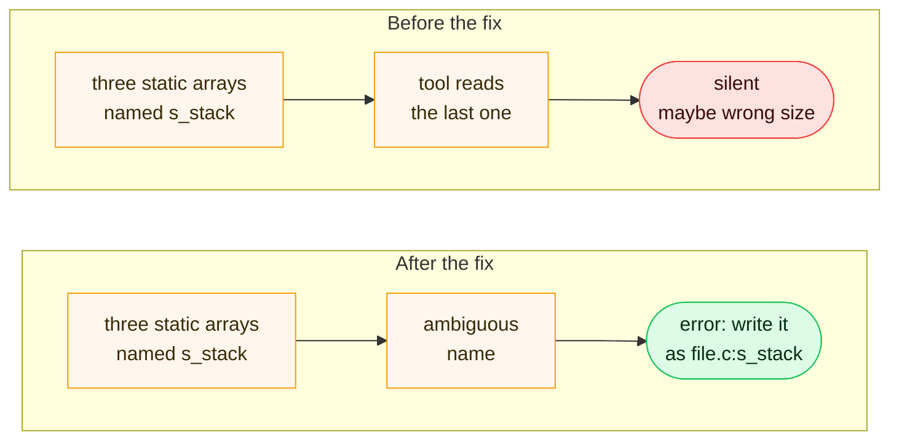

*The one bug that broke the tool's own rule: it guessed, silently.*

The other two were noise, not danger: **2,006** compiler entries on Node B for functions the linker had removed, and a header's `static inline` showing up once per file that uses it. Neither could change a number. The `s_stack` one could have.

<!-- tools/stack_bound/docs/adr/ADR-0001-architecture.md §8 Table 12; 2,006: docs/bench/2026-11-11/stack_bound_nodeB_cm7.txt. -->

### Three stacks failed the 80% rule, not one

I expected one failure: Node B's CAN task. Three stacks failed the 80% rule, two of them with under 64 B left. The third, Node A's `app` task, had 280 B left: not about to crash, but over the line. It signs the commands it sends, so it calls the same 568 B MAC function on the way out.

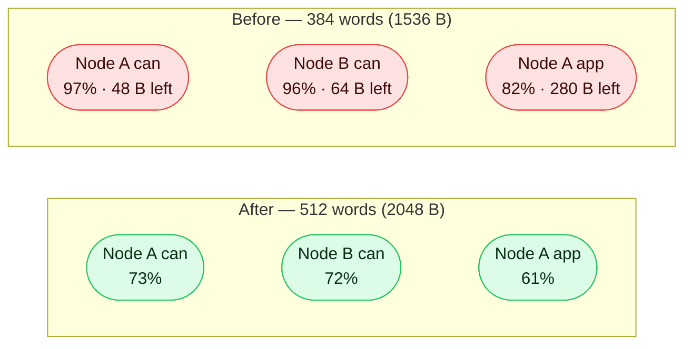

*Nov 11, static worst case including the 208 B switch frame, as a share of the stack. Every analysed task now passes the 80% rule.*

<!-- docs/project/findings.md F-021; ADR-0025 Table 4; docs/bench/2026-11-11/stack_bound_node*.txt. 48 B = 1536 − 1488; 64 B = 1536 − 1472; 280 B = 1536 − 1256 (Node A app_task: 1048 + 208). -->

The deepest branch on both CAN tasks is the error log after a failed MAC. It never runs on a healthy bench, but it's real: a fault test drove it 6,843 times. I raised the stacks rather than moving the MAC buffers to static memory: two tasks on Node A call the MAC, so static buffers would need a lock, and the RAM is there.

Honest — the tool counts every path, even two branches that can never run together, so it over-estimates; it never under-estimates as long as the bindings are complete, which is the one thing I still vouch for by hand.

### Does the bench agree?

I flashed both nodes through the gate and captured the logs. For every analysed task, the static number must be **at least** what the task really used.

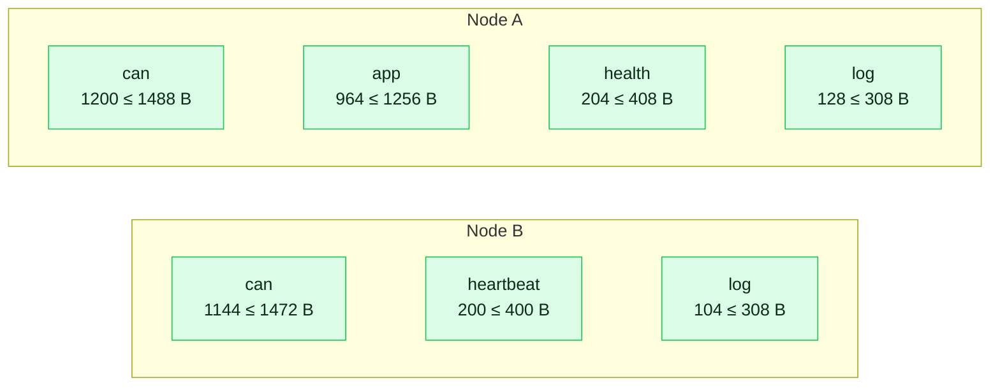

*Nov 11. Measured ≤ static on all 7 tasks; static includes the 208 B switch frame. The ~300 B gap on the CAN tasks is mostly the error branch the normal run skips.*

<!-- docs/bench/2026-11-11/stack_crosscheck.md Check 1; summary.txt. -->

On the old 1536 B stacks, the normal path alone used 78% (Node A) and 74% (Node B). No high-water mark would ever have shown the error branch on top.

### The gate stopped two good builds

The first two flash runs stopped at the gate with stacks that **passed**. The build shell gave Windows Python a `/cygdrive` path it couldn't open; then Python printed `pass\r` instead of `pass`. Both times the gate failed closed and flashed nothing. That's what I want from it, so I fixed the script, not the rule.

<!-- stack_crosscheck.md Check 3; commit 94ce2f5. -->

### The cost

```
Code bytes        identical with the analysis flags (both images)
RAM               +512 B per raised stack, 3 stacks
Log traffic       6 records every 5 s on Node A, 5 on Node B
Build time        +1.6–2.5 s per image
A new pointer     fails the build until I bind it (on purpose)
Interrupt stack   not analysed yet
```

<!-- ADR-0025 D7 / Table 7 (bytes); 384 → 512 words = +512 B; ADR-0025 D5 + stack_crosscheck.md Check 2 (log); stack_bound_failure_demo.md §3 (time). -->

Honest — the interrupt stack is not analysed yet, and every report says so in one line. That's exactly what the next slice adds.

---

## 7. User manual — check your own stacks

Build with `-g -fstack-usage -fcallgraph-info=su`, then:

```
python -m stack_bound build/app.elf --su build --project stack_bound.toml --html report.html
```

Success: one line per task, all `ok`. Node B's gate output on the bench day:

```
task can_task             1472 B      2048 B    72%    1840 B (460 w)  ok     ← the SecOC task
task heartbeat_task        400 B       512 B    78%     504 B (126 w)  ok
task log_cyclic_task       308 B       512 B    60%      392 B (98 w)  ok
not analysed: main stack (MSP): the interrupt chain and the code before …       ← says what it skips
   ~> crypto_mac 568 B   [listed: cy->oracle->mac: g_oracle = { crypto_mac } …] ← the pointer, with its reason
```

On the board, each task reports what it really used:

```
[   60000 app] LOG_EVT_TASK_STACK task_id=0x1 free_words=212   ← Node A can: (512 − 212) × 4 = 1200 B
```

<!-- docs/bench/2026-11-11/flash_nodeB.log lines 81–97 (shortened with "…"); docs/bench/2026-11-11/nodeA.txt line 215. -->

The failure demo — the best part. Delete the `verify_core` binding from the project file and run it again:

```
stack_bound: analysis error, no result:
  - task can_task: verify_core: indirect call at shared/secoc/src/secoc.c:139:10 has no binding (add an [[indirect]] entry)
```

Exit code 2, no number, and the build script stops before flashing. Point the binding at the wrong function instead, and it says *"never address-taken, so no pointer can hold it"*.

<!-- docs/bench/2026-11-14/stack_bound_failure_demo.md §1–2 (absolute path prefix shortened). -->

---

## Metadata

```
Board      · Node A: TRAVEO™ T2G Body Entry (CYT2B7, Cortex-M4F) · Node B: KIT_T2G-B-H_LITE (CYT4BF, Cortex-M7)
Toolchain  · ModusToolbox (GCC 14.2.1), Python
RTOS       · FreeRTOS
Tool       · stack_bound 0.2.0 (MIT) · pyelftools
Repo       · traveo-body-domain (main) · stack_bound (tag v0.2.0)
Written    · November 2026
```

## Follow along

💻 GitHub — Traveo II Body Domain

🔗 https://github.com/binhnguyenthanh051-ops/traveo-body-domain (main)

💻 GitHub — stack_bound

🔗 https://github.com/binhnguyenthanh051-ops/stack_bound (tag v0.2.0)

💻 LinkedIn

🔗 https://www.linkedin.com/in/binh-nguyen-thanh-2b807714b/

---

## Figures list
- `img/stack-2/hero.png` (from `hero.svg`, caption `TRAVEO T2G · STACKS 2/2`) and `img/stack-2/fig-01…11.png`, rendered by `host_tools/blog/render_diagrams.py`.
- Medium tags: Embedded Systems, Automotive, Static Analysis, FreeRTOS, Microcontrollers.
