# Stacks 2/2 — The CAN task that outgrew its stack, and the tool I built so it can't happen quietly again

*Part VII of Traveo II Domain — building an automotive body-domain network from scratch on an Infineon TRAVEO™ T2G, with the design done in the open and Claude used as a visible collaborator.*

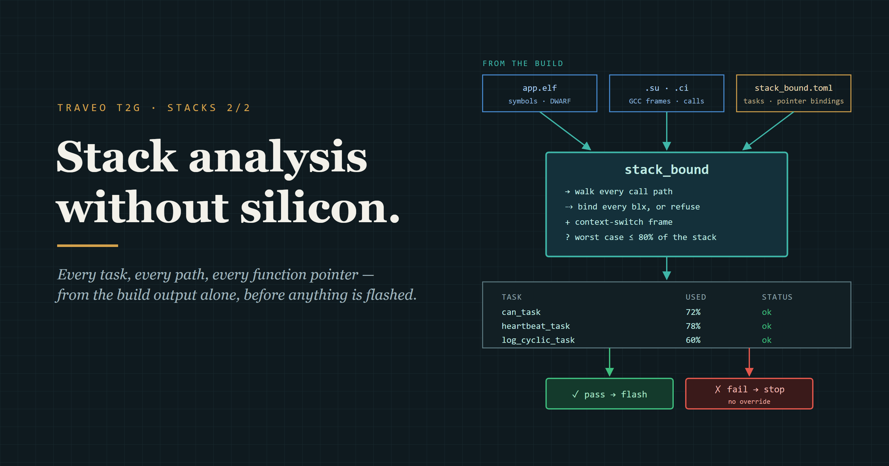

At the end of Post 1 I admitted the weak spot of FreeRTOS's high-water mark: *"the mark only knows the paths that ran. If one rare call goes deeper, and it never ran while I watched, the mark has no idea."*

That's how my CAN task overflowed. One call hid 568 bytes from me, and from every quick check I had. So I wrote a tool that works out each task's worst case from the build itself, before anything goes on the chip.

The first real run surprised me. The stack I'd already doubled after the overflow had just **48 bytes** to spare.

<!-- Post 1 quote: docs/blogs/stack-1-blog-draft.md §7 Honest line. 48 B = 1536 − 1488 (Node A can_task: docs/bench/2026-11-11/stack_bound_nodeA_app.txt; old stack 384 words, docs/project/findings.md F-021). 568 B: crypto_mac push {r4, r5, lr} + sub.w sp, sp, #556 (docs/bench/2026-11-14/stack_bound_asm_examples.md). -->

---

## 1. The incident

It happened during the M5 bring-up. Node B's CAN task got its first signed frame, started checking the signature (the MAC), and ran off the end of its stack. FreeRTOS caught it and called the overflow hook. The hook just loops forever, so a moment later the watchdog reset the chip.

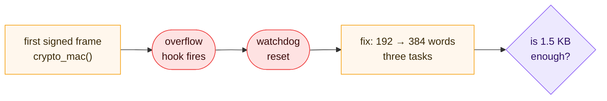

*I doubled three stacks. Nothing told me whether that was enough.*

<!-- docs/briefs/M5-bringup-plan.md row 14 (Node B can; Node A can + app had the same 192 words) and commit 0cab23f. -->

Before writing a real tool, I tried a 30-line script. It added up the frames along the calls and came back in seconds: **856 B** of calls, on a **768 B** stack. No debugger needed. The catch was function pointers. The script couldn't follow them, so I had to add those calls by hand.

The code kept growing after that, so you'll see several numbers for the same task in this post. Here they all are, with what each one counts:

```
Sep 28  Node B  prototype script     856 B   calls only
Nov 6   Node B  GCC's graph alone    552 B   calls, stops at the pointer
Nov 6   Node B  pointer followed    1256 B   calls, error log included
Nov 11  Node B  stack_bound         1264 B   + 208 B task switch = 1472 B
Nov 11  Node A  stack_bound         1280 B   + 208 B task switch = 1488 B
Nov 16  Node B  stack_bound         1256 B   + 208 B task switch = 1464 B   ← the GIFs below
```

<!-- 856: docs/briefs/M5-bringup-plan.md row 14 + docs/future-ideas.md (Sep 28 = idea date). Error log below the MAC: F-018, commit b17c7f5 (2026-11-06), 160 B deeper: docs/project/findings.md F-021. 552 / 1256: ADR-0025 Table 5. 1264 / 1280 + 208: docs/bench/2026-11-11/stack_bound_node*.txt. 1256 + 208 = 1464 (Nov 16 image, sha256 10b2b3d0577f): docs/bench/2026-11-17/stack_bound_nodeB.txt; 8 B less than Nov 11 = log_ring_put_locked 40 B replaced log_try_enqueue 48 B (the F-022 fix, 2026-11-12, stack_bound_asm_examples.md). -->

---

## 2. The call nobody can see

### Why did the compiler's own count miss it?

GCC can tell you every function's frame size and which functions it calls. Add those up for the CAN task and you get **552 B**. Follow one function pointer, and the same chain comes to **1256 B**.

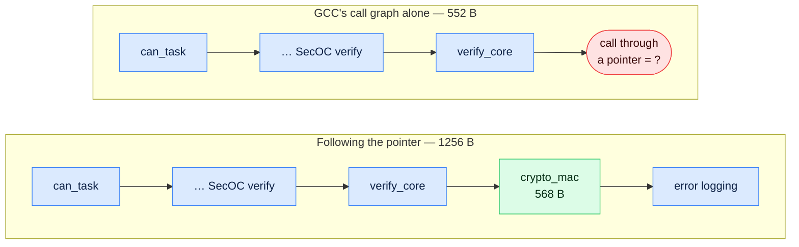

*Node B, Nov 6. The biggest frame is hiding behind a function pointer, and the compiler's count stops right there.*

<!-- 552 B vs 1256 B: ADR-0025 Table 5 (Node B spike, 2026-11-06). -->

The function in the middle, `verify_core`, checks a frame's MAC. It never calls the MAC code by name. It calls whatever a small interface points to:

```c
if (!cy->oracle->mac(cy->key_id, macin, macin_len, tag))
```

<!-- shared/secoc/src/secoc.c:139; g_oracle = { crypto_mac }: node_b_actuator/proj_cm7/src/secoc_app.c:27. -->

I put that pointer there on purpose. On the PC, my tests plug in a fake MAC; on the board, it's the real one, `crypto_mac`. Great for testing. But a simple count can't see through it.

### What does a pointer call look like to a tool?

In a normal call, the target address is part of the instruction. In a pointer call, it isn't. This is what that looks like inside `verify_core`, and how a tool can still dig the answer out of the program's data:

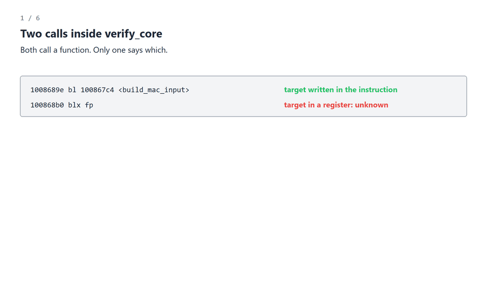

*From the instruction to the word in flash that holds `crypto_mac`'s address. All values come from the Node B image.*

<!-- docs/bench/2026-11-17/stack_bound_post2.md: nm, objdump -d (verify_core), objdump -s (0x10087ea0–0x10087ebf) of the Nov 16 image, same addresses as Nov 12. Drawn by host_tools/blog/stack_bound_gifs.py. -->

The giveaway is the **odd** number. On a Cortex-M, a function's address is always stored as its start + 1 (that's the Thumb bit from Post 1). So if some word in the program equals a function's start + 1, that function can be called through a pointer. The tool calls it **address-taken**.

---

## 3. The idea: walk every path, refuse to guess

The idea fits in two sentences. Every function gets a number, its **depth**: its own frame plus the deepest call below it. A task's worst case is then just the depth of its first function. Here's the tool doing that for the CAN task:

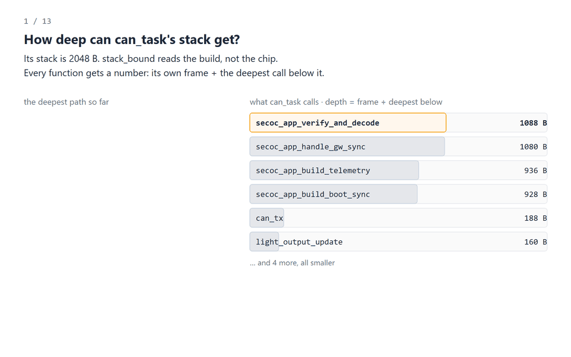

*At every step, the deepest call wins. One link, `verify_core → crypto_mac`, is only there because the tool followed the pointer.*

<!-- docs/bench/2026-11-17/can_task_walk.json: the tree stack_bound walks (host_tools/blog/stack_bound_walk.py, stack_bound as a library; its worst path and 1256 B are asserted equal to the tool's own report). Report: stack_bound_nodeB.txt, can_task 1464 B / 2048 B = 71 %, ok. -->

In pseudo code, the whole walk is only a few lines:

```
depth(f):
    if f has no known frame:      error "no frame"          # never count it as 0 B
    if f is already on the path:  error "recursion"
    worst = 0
    for each call in f:
        if it's a direct call (bl):    targets = [the address in the instruction]
        if it's a pointer call (blx):  targets = binding(call) or error "no binding"
        for t in targets:
            worst = max(worst, depth(t))
    return frame(f) + worst

required(task) = depth(task) + 208 B        # room for one task switch, Post 1
pass if required ≤ 80% of the task's stack
```

A **binding** is just me writing down what a pointer can hold. And one rule matters more than all the others: **never guess**. A wrong "pass" is worse than no answer at all. So when the tool can't give a safe number, it gives none, and tells you why.

---

## 4. How the tool works

### Which source do I trust?

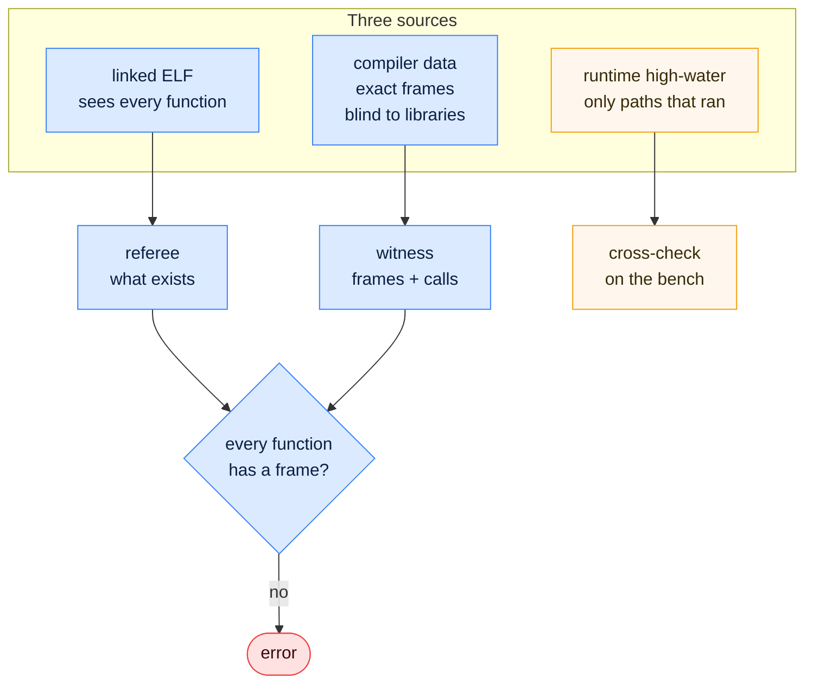

*The linked program decides what exists. The compiler gives the numbers. The bench checks the tool.*

- **Compiler data alone** misses code that comes prebuilt. `memcpy` ships in the C library without a frame file, so a script would count it as 0 B. The tool makes me write down 8 B, and where that number came from.
- **The high-water mark alone** only sees what ran. It still has a job, though: it checks the tool. If the bench ever measures more than the tool predicted, the tool is wrong.

### Five steps

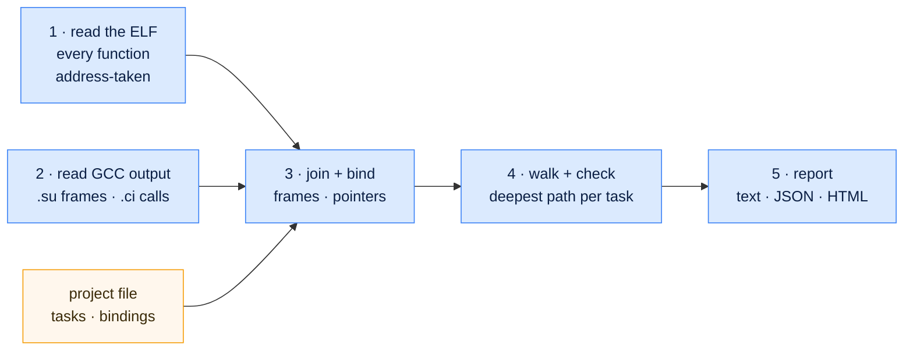

*About 1,000 lines of Python. It runs on the PC after every firmware build.*

1. **Read the ELF**, the linked program, to get every function and its address. Any word that equals a function's start + 1 marks that function as address-taken.
2. **Read GCC's output.** Two compiler flags make GCC write a frame file and a call file for each source file. If the tool meets a line it doesn't understand, it stops. It never skips it.
3. **Join and bind.** Match every function to its frame, and every pointer call to its binding in the project file.
4. **Walk and check**, as in section 3.
5. **Report** the result as text, JSON, and an HTML page that opens offline on a bench PC.

Here's the binding for `verify_core`'s pointer call. The reason is what the report prints next to it:

```toml
[[indirect]]
function = "verify_core"
targets  = ["crypto_mac"]
reason   = "cy->oracle->mac: g_oracle = { crypto_mac } (secoc_app.c:27), the only secoc_mac_if_t in the image"
```

The tool doesn't take my word for it, though. Here's what happens when the binding is missing, or wrong:

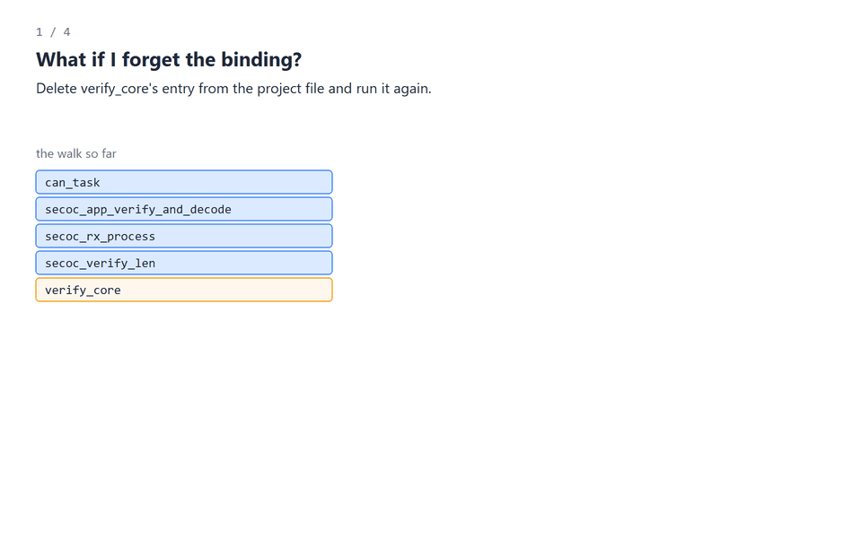

*Forget the binding, or point it at a function no pointer can hold, and you get no number and exit code 2. These are the real messages.*

<!-- docs/bench/2026-11-17/refusal_nobinding.txt and refusal_wrongtarget.txt (edited copies of node_b_actuator/proj_cm7/stack_bound.toml, run on the Nov 16 image); absolute path prefix shortened in the GIF. Same messages as docs/bench/2026-11-14/stack_bound_failure_demo.md. -->

Honest — for now I still write the bindings myself, and the tool checks each one against the binary. Teaching it to follow the stored values on its own is the next step.

### Why 80%?

The worst path has to fit in **80%** of the stack. The other 20% leaves room for the next small change to some error path, the kind nobody ever runs on the bench. I didn't want a fixed number of bytes, because that doesn't scale: 64 B is plenty on a 512 B stack and almost nothing on 2 KB.

```
Language     Python 3.11+, pyelftools
Input        the ELF built with -g, plus GCC -fstack-usage -fcallgraph-info=su
Exit codes   0 pass · 1 a stack fails · 2 no safe result · 3 usage error
Tests        47
Run time     1.6–2.5 s per image on my PC
```

<!-- 47: pytest on tools/stack_bound v0.2.0 (2026-11-14). Run time: docs/bench/2026-11-14/stack_bound_failure_demo.md §3. ~1,000 lines: wc -l tools/stack_bound/src = 1,057 incl. the profile. 9 [[indirect]] entries in each stack_bound.toml. -->

Nothing in the tool is specific to this project, so I gave it its own public repo, **stack_bound**.

### Where it runs

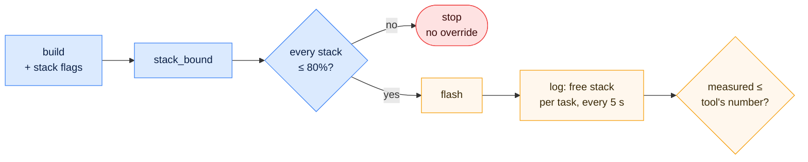

*Blue runs on the PC, amber on the board. The build checks the stacks; the bench checks the tool.*

The check lives in the same build scripts I flash with, so I can't forget to run it. And there's no override. If a stack fails, I fix the code or give the stack more room.

---

## 5. The test

### The first real image broke the tool

All my test programs passed. Then I pointed the tool at the real firmware, and found bugs in the **tool**. A vendor SDK does things my little test programs never did.

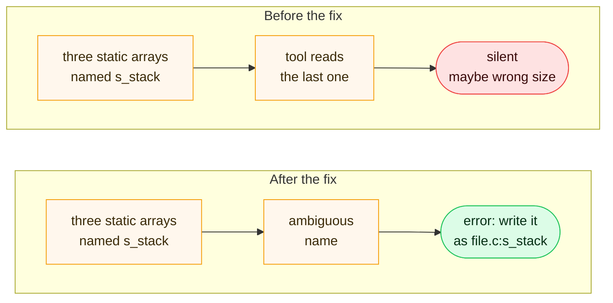

*The one bug that broke the tool's own rule: it guessed, silently.*

The other two bugs were just noise: **2,006** compiler entries on Node B for functions the linker had thrown away, and a header's `static inline` showing up once in every file that used it. Neither could change a number. The `s_stack` one could have.

<!-- tools/stack_bound/docs/adr/ADR-0001-architecture.md §8 Table 12; 2,006: docs/bench/2026-11-11/stack_bound_nodeB_cm7.txt. -->

### Three stacks failed the 80% rule, not one

I expected one failure, Node B's CAN task. I got three. Two of them had less than 64 B left. The third, Node A's `app` task, still had 280 B, so it wasn't about to crash, but it was over the line. It signs every command it sends, so it calls the same 568 B MAC function too.

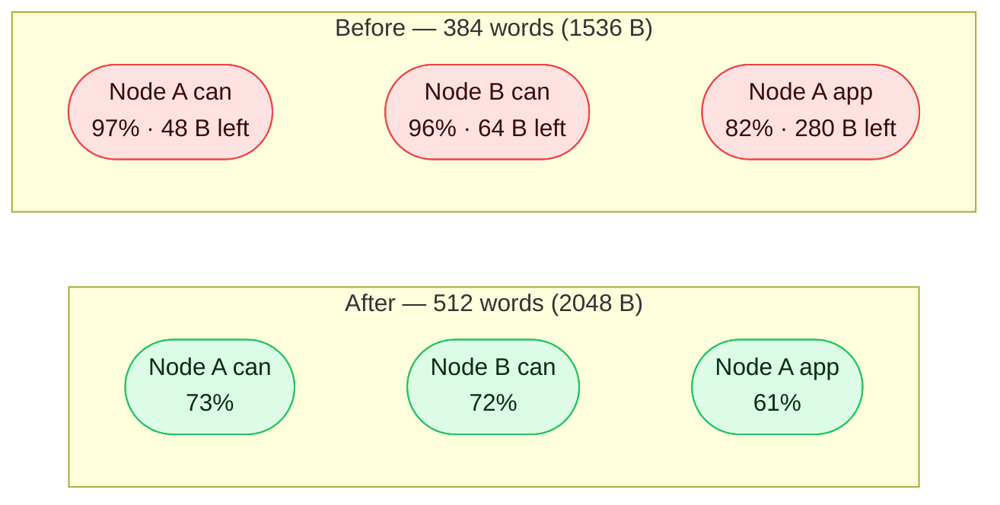

*Nov 11, worst case including the 208 B task switch, as a share of the stack. Every analysed task now passes.*

<!-- docs/project/findings.md F-021; ADR-0025 Table 4; docs/bench/2026-11-11/stack_bound_node*.txt. 48 B = 1536 − 1488; 64 B = 1536 − 1472; 280 B = 1536 − 1256 (Node A app_task: 1048 + 208). -->

On both CAN tasks, the deepest branch is the error log that runs after a failed MAC. On a healthy bench it never runs. But it's real: one fault test drove it 6,843 times. I chose to raise the stacks instead of moving the MAC buffers to static memory. Two tasks on Node A call the MAC, so shared static buffers would need a lock, and there's RAM to spare.

Honest — the tool counts every path, even two branches that can never run together, so it over-estimates a little. It never under-estimates, as long as the bindings are complete. That's the one part I still check by hand.

### Does the bench agree?

Then I flashed both nodes through the check and captured their logs. For every task the tool analysed, its number had to be **at least** what the task really used on the chip.

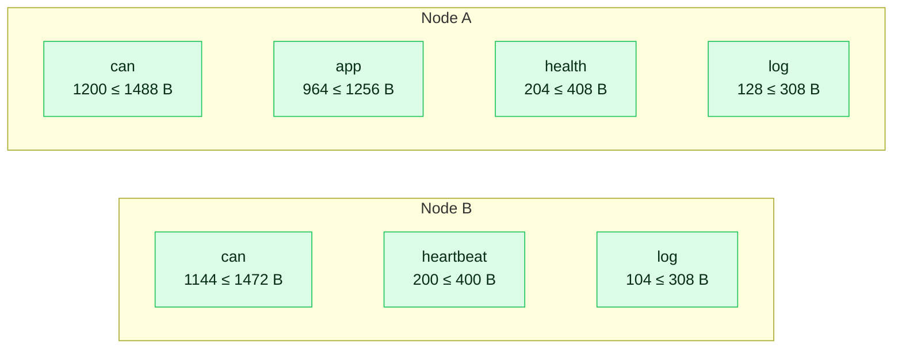

*Nov 11. Measured ≤ the tool's number on all 7 tasks. The ~300 B gap on the CAN tasks is mostly the error branch a normal run skips.*

<!-- docs/bench/2026-11-11/stack_crosscheck.md Check 1; summary.txt. -->

With the old 1536 B stacks, the normal path alone already used 78% on Node A and 74% on Node B. A high-water mark would never have shown me the error branch sitting on top of that.

### The check stopped two good builds

Funny enough, my first two flash runs stopped at the check even though every stack **passed**. First the build shell handed Windows Python a path it couldn't open. Then Python printed `pass\r` instead of `pass`. Both times the check refused and flashed nothing, which is exactly what I want when something's off. So I fixed the script and left the rule alone.

<!-- stack_crosscheck.md Check 3; commit 94ce2f5. -->

### The cost

```
Code bytes        identical with the analysis flags (both images)
RAM               +512 B per raised stack, 3 stacks
Log traffic       6 records every 5 s on Node A, 5 on Node B
Build time        +1.6–2.5 s per image
A new pointer     fails the build until I bind it (on purpose)
Interrupt stack   not analysed yet
```

<!-- ADR-0025 D7 / Table 7 (bytes); 384 → 512 words = +512 B; ADR-0025 D5 + stack_crosscheck.md Check 2 (log); stack_bound_failure_demo.md §3 (time). -->

Honest — the tool doesn't check the interrupt stack yet (the main stack from Post 1), and every report says so in one line. That's the next thing I'm adding.

---

## 6. User manual — check your own stacks

Build with `-g -fstack-usage -fcallgraph-info=su`, then:

```
python -m stack_bound build/app.elf --su build --project stack_bound.toml --html report.html
```

If all is well, you get one line per task, all `ok`. This is Node B, on the Nov 16 image:

```
task can_task             1464 B      2048 B    71%    1832 B (458 w)  ok     ← the CAN task
task heartbeat_task        392 B       512 B    77%     496 B (124 w)  ok
task log_cyclic_task       308 B       512 B    60%      392 B (98 w)  ok
not analysed: main stack (MSP): the interrupt chain and the code before …       ← says what it skips
   ~> crypto_mac 568 B   [listed: cy->oracle->mac: g_oracle = { crypto_mac } …] ← the pointer, with its reason
```

<!-- docs/bench/2026-11-17/stack_bound_nodeB.txt (shortened with "…"). -->

On the board, each task logs what it really used:

```
[   60000 app] LOG_EVT_TASK_STACK task_id=0x1 free_words=212   ← Node A can: (512 − 212) × 4 = 1200 B
```

<!-- docs/bench/2026-11-11/nodeA.txt line 215. -->

For the failure demo, delete the `verify_core` binding from the project file and run it again. You should get exit code 2, no number, and this:

```
stack_bound: analysis error, no result:
  - task can_task: verify_core: indirect call at shared/secoc/src/secoc.c:139:10 has no binding (add an [[indirect]] entry)
```

<!-- docs/bench/2026-11-17/refusal_nobinding.txt (absolute path prefix shortened). -->

The build script then stops before flashing.

---

## Metadata

```
Board      · Node A: TRAVEO™ T2G Body Entry (CYT2B7, Cortex-M4F) · Node B: KIT_T2G-B-H_LITE (CYT4BF, Cortex-M7)
Toolchain  · ModusToolbox (GCC 14.2.1), Python
RTOS       · FreeRTOS
Tool       · stack_bound 0.2.0 (MIT) · pyelftools
Repo       · traveo-body-domain (main) · stack_bound (tag v0.2.0)
Written    · November 2026
```

## Follow along

💻 GitHub — Traveo II Body Domain

🔗 https://github.com/binhnguyenthanh051-ops/traveo-body-domain (main)

💻 GitHub — stack_bound

🔗 https://github.com/binhnguyenthanh051-ops/stack_bound (tag v0.2.0)

💻 LinkedIn

🔗 https://www.linkedin.com/in/binh-nguyen-thanh-2b807714b/

---

## Figures list
- `img/stack-2/hero.png` (from `hero.svg`, caption `TRAVEO T2G · STACKS 2/2`) and `img/stack-2/fig-01…08.png`, rendered by `host_tools/blog/render_diagrams.py`.
- `img/stack-2/stack-fnptr.gif`, `stack-walk.gif`, `stack-refusal.gif`: `host_tools/blog/stack_bound_gifs.py` from `docs/bench/2026-11-17/` (needs Pillow).
- Medium tags: Embedded Systems, Automotive, Static Analysis, FreeRTOS, Microcontrollers.
