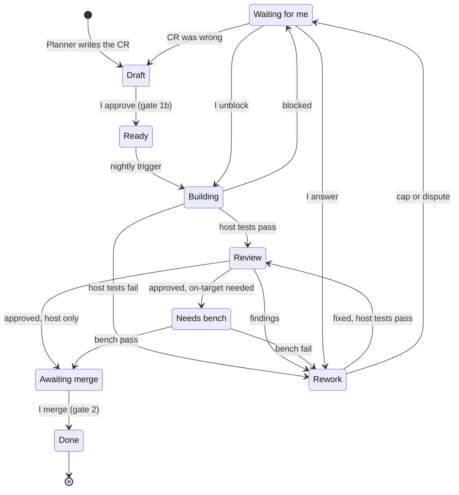
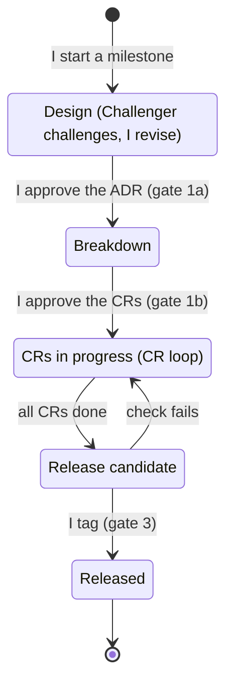

# Design note: agent pipeline

- status: approved by me on 2026-11-12
- owner: Binh
- repo path: `docs/design/agent-pipeline.md`
- open items: the six `[TODO]` entries were filled in from the repo by Claude Code on
  2026-11-12 (sections 7 and 11). I confirm them by merging this note. One stays open: the
  scope of the release integration test (section 11).

---

## 1. Goal and non-goals

**Two loops**

- **Milestone loop (outer):** I do the design and decide the requirements for a milestone, as
  an ADR written together with Claude Code. A milestone ends with a software release and a tag.
  See section 11.
- **CR loop (inner):** each CR goes from `ready` to a merged pull request. See sections 2 to 8.

**Goal**

- I do not write CRs or bug reports line by line. Claude Code breaks the approved design down
  into CRs and writes bug reports for me.
- The pipeline does the coding, the code review, the rework, the testing and the pull request.
- Tests are run and judged by script. For on-target tests I only power up and plug the board.
- The Challenger gives ideas, teaches and guides me on requirements and design, as a coach for
  a new architect who is learning to become a senior architect and domain expert.

**Non-goals**

- The pipeline never decides the design.
- The pipeline never merges. Only I merge.
- The pipeline never tags a release. Only I tag.

**Measurable goals**

- At least 2 CRs or bug fixes merged per week, starting the week of 2026-11-16.
- At least 1 blog per week. Anything beyond these is a bonus.
- One new AI skill, plug-in or technique applied to the repo every 2 weeks. It is raised as a
  CR on the pipeline itself, so it passes the same gates.
- The first CRs are the pipeline's own build steps (section 9), so the weekly goal and the
  pipeline build do not compete.

---

## 2. Roles

One agent can appear in more than one state. The diagram in section 6 shows states, not actors.

| Role | Type | Reads | Writes | Never |
|---|---|---|---|---|
| Me | human | everything | requirements, ADRs and design notes (with Claude Code), approvals, merges, release tags | - |
| Challenger | agent | my draft ADR or design note, requirements, architecture doc, the Planner's breakdown | questions and findings | writes the design, approves anything |
| Planner | agent | the approved ADR, requirements | CRs and bug reports as `draft` issues | changes the design, sets `ready` |
| Builder | agent | the CR, design note, repo | branch, tests, code, pull request, rework fixes | merges, changes protected files (section 7), widens the scope of a CR |
| Inspector | agent | the pull request, the CR, the design note only | review verdict and findings on the pull request | sees the Builder's reasoning, edits code |
| Test station | script | the code | pass or fail, and logs | - |

**Rules for the roles**

- The Inspector is independent: fresh context, read-only tools, no access to the Builder's reasoning.
- Test is a deterministic script, not an agent. An agent may read a failure log afterwards, but
  the verdict is the script's exit code.
- Tests are written before the code, from the CR's acceptance criteria.
- The Builder's first commit holds only the tests, and they must fail. The pull request shows
  this, so "test before code" is evidence and not a promise.
- The Inspector checks the tests against the CR: every acceptance criterion has at least one
  test that would fail if the criterion were not met.

**Builder: two states**

| | Build | Rework |
|---|---|---|
| Input | the CR and the design note | findings or a failed test log |
| Scope | implement the whole CR | fix only what was reported |
| Limit | once per CR | max 2 rounds, then I referee |

**Test station: two test levels**

| | Host tests | On-target tests |
|---|---|---|
| Runs on | cloud CI | my PC with the board, through the existing bench-test skill in Claude Code |
| Trigger | every push, automatic | only when the CR asks for it, and I plug |
| Catches | logic errors | timing, hardware and integration errors |

---

## 3. Triggers

| Step | Trigger |
|---|---|
| Challenger, design | I draft or change the ADR or design note for a milestone (the design session) |
| Planner, breakdown | I approve the ADR (gate 1a) |
| Planner, bug report | I describe a bug to Claude Code, or a test or agent finds one |
| Challenger, breakdown check | the Planner finishes a breakdown: each CR traces to the ADR and has testable acceptance criteria |
| Builder, build | nightly schedule at 01:00 SGT; takes the oldest `ready` CR; one CR per run |
| Host tests | every push to a pull request (existing CI) |
| Inspector | host tests are green on the pull request, so it never reviews failing code |
| Builder, rework | the label changes to `rework` (Inspector findings or a failed test) |
| On-target tests | label `needs-bench`; I plug the board and start the local bench run |
| Merge gate | label `awaiting-merge`; I get a notification |
| Idle | no `ready` CR: the Builder does nothing and waits |

- On-target tests are not limited to Saturday. The pipeline "books the station" and I plug in
  on a weeknight. No manual debugging on weeknights.
- How each agent is started (GitHub Action, cloud scheduled task, or local Claude Code) is for
  Claude Code to propose in the first build CR. Cloud is preferred. Only the bench run must be local.

---

## 4. Handoffs

- All handoffs live in the repo or on GitHub. Nothing lives in chat.
- One unit of work, the **Change Request (CR)**. A new feature is a CR with type "new".
  A bug is a **bug report**. "PR" always means pull request.
- Each CR or bug report is one GitHub issue, written by the Planner from an issue form.
- Each CR belongs to one GitHub milestone (for example M6), so the release gate can see when
  a milestone is complete.
- CR label = board column. Board: GitHub Projects. Stage view of a run: GitHub Actions.

**Issue forms** (`.github/ISSUE_TEMPLATE/`)

| Form | Fields |
|---|---|
| Change request | what and why, ADR link, requirement IDs, acceptance criteria, test level (host / on-target / both), milestone |
| Bug report | observed, expected, how to reproduce, affected requirement, test level, milestone |

**"Agent-ready" definition**

- A CR is agent-ready only when every field is filled and I have set `ready`. If a field is
  empty, the Builder does not start.
- Only I can set `ready`. Every CR and bug report starts as `draft`, whoever wrote it.
- I approve a breakdown as a list: the title and the acceptance criteria of each CR. I do not
  read every line, but the acceptance criteria are mine to approve.

**States and labels**

| Label / column | Meaning | Who moves it on |
|---|---|---|
| `draft` | written by the Planner, waiting for my approval | me (gate 1b) |
| `ready` | approved, waiting for the Builder | Builder |
| `building` | Builder is implementing; host tests run on each push | CI |
| `review` | Inspector is reviewing | Inspector |
| `rework` | Builder is fixing findings or a failed test | CI |
| `needs-bench` | waiting for me to plug the board | bench script |
| `awaiting-merge` | all evidence is there, waiting for me | me (gate 2) |
| `waiting-for-me` | blocked, disputed, cap reached or protected change | me |
| `done` | merged | - |

**Other carriers**

- The pull request links the CR and carries the rework round counter, for example "rework round 1 of 2".
- Review findings are pull request comments. Test results are CI checks.
- The bench result is posted back on the pull request, so the merge check can see it.

---

## 5. Gates

| Gate | I decide | Evidence I look at |
|---|---|---|
| 1a. Design | the ADR and requirements for the milestone are right | the Challenger's findings, all answered |
| 1b. Breakdown | the CRs are good enough to build (`ready`) | the CR list with acceptance criteria, and the Challenger's breakdown check |
| 2. Merge | the change goes in | CI green, Inspector verdict, traceability, bench result if the CR needs it |
| 3. Release | the milestone is released and tagged | the Definition of Done (section 11) |
| Referee | how to continue blocked or disputed work | the Builder's question, or both sides of the dispute |

- No test or no traceability means no merge. This is a CI check that fails the pull request,
  so it is impossible and not only forbidden.
- The bench result is a required check when the CR's test level includes on-target.
- At gate 2 I read the Inspector's findings, the test results and the traceability. I do not
  read the diff line by line. For anything I cannot explain at design level, I ask until I can.
- Gate window: I handle my gates in one batch, at night on weekdays or at some time on the
  weekend. I do not react to each notification.
- I approve a breakdown once per milestone, as one list.

---

## 6. Failure modes and state machine (CR loop)

| Failure | What happens |
|---|---|
| I reject a draft CR | the Planner rewrites it; it stays `draft` |
| Host tests fail | Builder reworks, then host tests run again |
| Inspector has findings | Builder reworks, then host tests and review run again |
| Tests pass but test the wrong thing | Inspector checks tests against the acceptance criteria; findings go to rework |
| On-target test fails | Builder reworks; the change goes through host tests and review again, and the bench test always runs again before merge |
| Rework cap reached (2 rounds) | stop, `waiting-for-me` |
| Builder and Inspector disagree | I am the referee |
| Builder is blocked or unsure | stop, `waiting-for-me`; it does not guess |
| Change needs a protected file | stop, `waiting-for-me`, with a proposal (section 7) |
| CR itself was wrong | after I referee, back to `draft`; the Planner rewrites it |
| The design was wrong, not the CR | the CR is paused; I change the ADR and pass gate 1a again |
| CR fields missing | Builder does not start |
| Queue empty | Builder waits |
| A run did not happen (pipeline down) | every run leaves one status line, also when it did nothing ("no ready CR"); no line means the pipeline is down |

**After I referee**

- Two paths: back to the Builder with my answer, or back to `draft`.
- The round counter does not reset. The Builder gets one more round with my answer. If that
  round also fails, the CR goes back to `draft`.

---

## 7. Limits

- One CR per Builder run.
- Rework cap: 2 rounds.
- The Builder never changes these without my approval as referee:
  - requirements (`docs/requirements/`)
  - design notes (`docs/design/`)
  - architecture of the platform and software (`docs/architecture/overview.md`, ADRs in
    `docs/architecture/decisions/`)
  - CI workflows (`.github/workflows/`)
  - linker scripts: every `*.ld`, `*.sct` and `*.icf` file. Today these are
    `node_a_gateway/app/linker/`, `node_a_gateway/bootloader/proj_cm4/linker/`,
    `shared/boot/linker/` and the BSP `linker*` files under `node_a_gateway/bootloader/bsps/`
    and `node_b_actuator/bsps/`.
  - anything with keys:
    - key material and key IDs: `security/` (`secoc_shared_secret.h`, `secoc_key_id.h`) and
      `node_a_gateway/bootloader/proj_cm0p/src/crypto_pubkey_dev.h`
    - the keystore: `shared/crypto/include/crypto_keystore.h` and
      `shared/crypto/src/crypto_keystore.c`
    - the key tools: `host_tools/gen_dev_key.py`, `host_tools/sign_image.py` and
      `host_tools/check_key_residency.py`
    - the secret patterns in `.gitignore`
  - the plan and week files (`docs/project/`) and `CLAUDE.md`
  - the agent definitions (prompts, skills, workflows)
- If a CR needs a change to linker, keys or architecture, the Builder stops, sets
  `waiting-for-me` and describes the change it wants. I approve or reject as referee.
- Enforced by a CI path check: a pull request that touches a protected path fails unless I
  added the label `protected-change-approved`.
- "Never merges" is enforced by branch protection on `main` (only I can merge, checks are
  required), not by an instruction to the agent.
- No agent creates a tag or a release.
- Pause switch: one label or file that makes every agent stop at its next start.

**Trust boundary (the repo is public)**

- Agents take instructions only from issues and comments written by me. Everything else
  (other people's issues and comments, pull requests from forks, test logs, web pages) is data
  and is never followed as an instruction.
- Agent runs do not start on pull requests from forks.
- Least privilege per agent: the Builder can push branches and open pull requests, and nothing
  else. The Inspector, Challenger and Planner can read and comment. No agent can push to
  `main`, change a workflow or create a tag.
- No key material in cloud runs or in logs. Anything that needs keys runs locally.
- My PC is not registered as a CI runner for the public repo. I start the bench run locally myself.

---

## 8. Acceptance criteria

After two weeks of running (by 2026-11-29) the pipeline works if:

- 2 CRs or bug fixes per week were merged, and I did not write or edit the code.
- Every merged pull request has tests and traceability.
- Every merged pull request shows its tests failing before the code was added.
- No pull request was merged by an agent, and no protected file changed without my label.
- Every on-target verdict came from the script's exit code.
- No CR used more than 2 rework rounds without stopping for me.
- Three numbers are logged per CR: rework rounds, time from `ready` to merge, and referee calls.
  No number goes into a blog before it is measured.

Later check, not in the two weeks: the first milestone built this way is released through
gate 3 with the Definition of Done met.

---

## 9. Build order

Target: all steps this week, by 2026-11-15. Each step is its own CR and pull request.

1. Issue forms, labels, GitHub milestones and the GitHub Projects board.
2. Branch protection on `main` and the required checks (tests, traceability, protected paths).
3. One tiny CR walked through by hand: I start every stage manually. This proves the handoffs.
4. Builder on its nightly trigger, with the status line for every run.
5. Inspector on its trigger. Retire the old noon reviewer routine, so there is one reviewer.
6. Planner: breakdown from an approved ADR, and bug reports on request.
7. Challenger: design session support and the breakdown check.
8. Bench run wired to `needs-bench`, result posted as a check.
9. Release check against the Definition of Done, as a script or workflow (section 11).
10. Pause switch and the three numbers per CR.
11. Later: integration test for release, as its own CR (section 11).

---

## 10. Changes needed in `docs/project/plan.md`

These are made at the Sunday retro on 2026-11-15, not before.

1. Weekday hardware rule: "Weekdays: no bench work. Exception: I may power and plug the board
   for a scripted on-target test the pipeline has booked. No manual debugging."
2. "No new detours before Dec 6": the agent pipeline is now planned work, not a detour.
3. Weekly goal: from "one small delivery or blog every 1 to 2 weeks" to "2 CRs or bug fixes
   and 1 blog per week, and one new AI technique every 2 weeks".

Until then the Sunday task still plans against the old rules.

---

## 11. Milestone and release loop

The CR loop ends at a merged pull request. A release needs a whole milestone, so it is a
second, slower loop around the first one.

**Definition of Done for a release**

- The repo already has a Definition of Done for tag and release (all tests pass, all
  traceability closed). That DoD is the source of truth: rule 11 in
  [`docs/project/plan.md`](../project/plan.md), nine checks. Two parts of it are already
  automated: the traceability gate in `.github/workflows/ci.yml`, and
  `.github/workflows/release.yml`, which runs the full host CI again before it tags.
- Compare it against the list below. Anything missing is added to the DoD itself, so there is
  one DoD and not two.
  - Every CR and bug report of the milestone is `done`, or moved to a later milestone by me.
  - Full host regression is green on `main`.
  - Full on-target regression has passed on the release commit. I plug, the script judges.
  - `/architecture-doc check` reports no drift between the architecture doc and the code.
  - The traceability report is complete for the milestone's requirements.
  - Release notes are generated from the merged CRs.

**Test level at release**

- Today the release checks run module-level tests, the same level as the CR loop.
- Later, Claude Code builds an integration test for release. It is raised as its own CR.
  Its scope is my design decision: still open. Nothing in the repo sets it yet, so I decide
  it in the ADR for build step 11. Starting material: `docs/briefs/BVT-bench-brief.md`
  (a hardware build verification test over CAN) and roadmap EP.13 (integration tests in CI).
- Until it exists, the release notes say that the release was verified at module level only.

**Rules**

- Only I create the tag, and only when the DoD is met. Tag scheme: `m<number>[letter]-<slug>`,
  for example `m5-secoc` and `m5b-secoc`. `.github/workflows/release.yml` checks the name
  against `^m[0-9]+[a-z]?-[a-z0-9-]+$`. The tag is annotated and set on `main` by that
  workflow, which I start by hand. It also creates the GitHub Release, with notes from
  `docs/releases/<tag>.md` and the traceability report attached.
- A failed check never gets fixed directly on the release candidate. It becomes a bug report
  and goes through the CR loop.
- After the tag: the architecture doc is updated, and the milestone blog is drafted.

---

## 12. Where the agents live

In this repo (`traveo-body-domain`), not in a separate repo.

| What | Where |
|---|---|
| Agent definitions (Challenger, Planner, Builder, Inspector) | `.claude/agents/` |
| Skills (bench test, architecture doc) | `.claude/skills/` |
| Triggers and checks | `.github/workflows/` |
| Issue forms | `.github/ISSUE_TEMPLATE/` |
| This note | `docs/design/agent-pipeline.md` |

- Why the same repo: the agents need the repo's context, the pipeline is versioned with the
  code (a release tag also records the pipeline that built it), and there is one place to
  protect and review.
- Where an agent runs is a separate question from where it is defined: cloud for the
  Challenger, Planner, Builder and Inspector, and my PC for the bench run.
- If I later reuse the pipeline on another project, I extract it into a template repo then.
  Until then that is one line in `docs/future-ideas.md`.
- Claude Code confirms the exact folder layout.

---

## History

- 2026-11-11: design started from scratch.
- 2026-11-12: Planner role, split gate 1, milestone and release loop, tests before code,
  trust boundary, agent location. Approved by me.
- 2026-11-12: `[TODO]` entries filled in from the repo by Claude Code (sections 7 and 11).
- M5 (SecOC) was closed before this pipeline starts.
