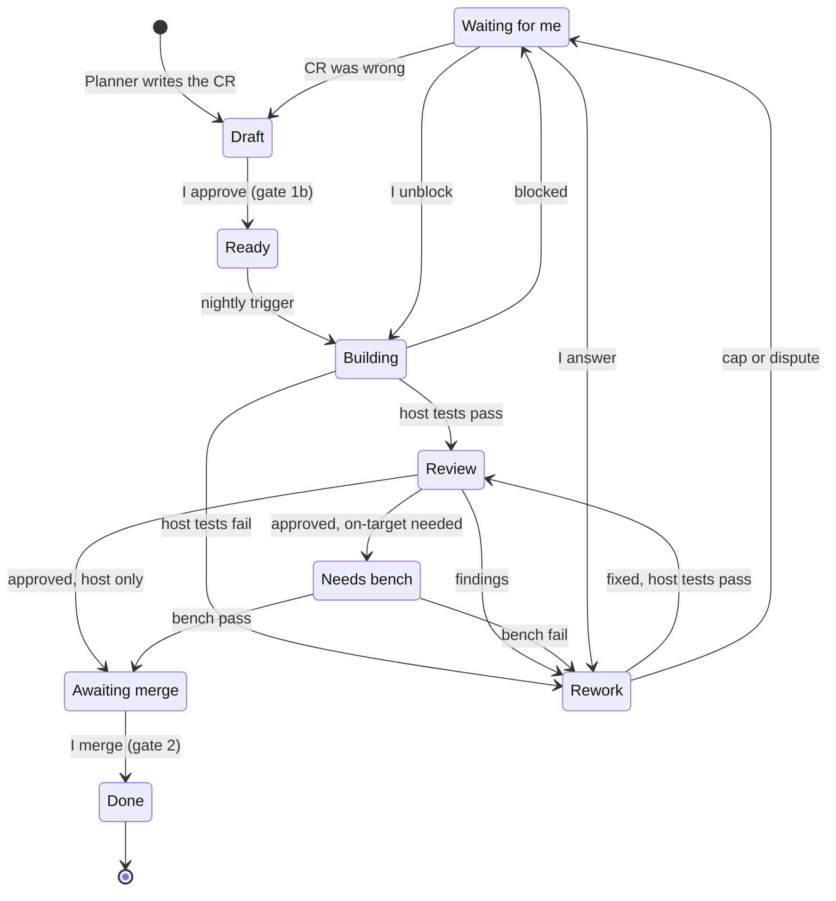
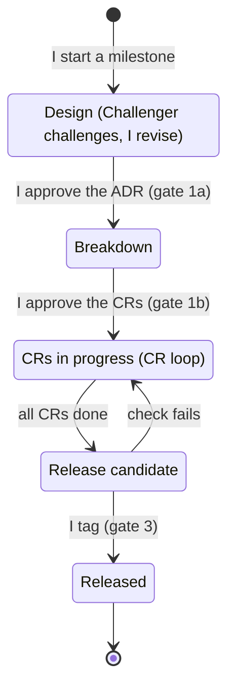

# Design note: agent pipeline

- status: approved by me on 2026-11-12
- owner: Binh
- repo path: `docs/design/agent-pipeline.md`
- open items: the nine `[TODO]` entries were filled in by Claude Code on 2026-11-12, from the
  repo, the TRM, the GitHub API and the Claude Code docs (sections 7, 11 and 13). I confirm
  them by merging this note. Still open: the scope of the release integration test
  (section 11), and the irreversible steps on Node B, whose TRM is not in the repo (section 13).

---

## 1. Goal and non-goals

**Two loops**

- **Milestone loop (outer):** I do the design and decide the requirements for a milestone, as
  an ADR written together with Claude Code. A milestone ends with a software release and a tag.
  See section 11.
- **CR loop (inner):** each CR goes from `ready` to a merged pull request. See sections 2 to 8.

**Goal**

- I do not write CRs or bug reports line by line. Claude Code breaks the approved design down
  into CRs and writes bug reports for me.
- The pipeline does the coding, the code review, the rework, the testing and the pull request.
- Tests are run and judged by script. For on-target tests I only power up and plug the board.
- The Challenger gives ideas, teaches and guides me on requirements and design, as a coach for
  a new architect who is learning to become a senior architect and domain expert.

**Non-goals**

- The pipeline never decides the design.
- The pipeline never merges. Only I merge.
- The pipeline never tags a release. Only I tag.

**Measurable goals**

- At least 2 CRs or bug fixes merged per week, starting the week of 2026-11-16.
- At least 1 blog per week. Anything beyond these is a bonus.
- One new AI skill, plug-in or technique applied to the repo every 2 weeks. It is raised as a
  CR on the pipeline itself, so it passes the same gates.
- The first CRs are the pipeline's own build steps (section 9), so the weekly goal and the
  pipeline build do not compete.

---

## 2. Roles

One agent can appear in more than one state. The diagram in section 6 shows states, not actors.

| Role | Type | Reads | Writes | Never |
|---|---|---|---|---|
| Me | human | everything | requirements, ADRs and design notes (with Claude Code), approvals, merges, release tags | - |
| Challenger | agent | my draft ADR or design note, requirements, architecture doc, the Planner's breakdown | questions and findings | writes the design, approves anything |
| Planner | agent | the approved ADR, requirements | CRs and bug reports as `draft` issues | changes the design, sets `ready` |
| Builder | agent | the CR, design note, repo | branch, tests, code, pull request, rework fixes | merges, changes protected files (section 7), widens the scope of a CR |
| Inspector | agent | the pull request, the CR, the design note only | review verdict and findings on the pull request | sees the Builder's reasoning, edits code |
| Test station | script | the code | pass or fail, and logs | - |

**Rules for the roles**

- The Inspector is independent: fresh context, read-only tools, no access to the Builder's reasoning.
- Test is a deterministic script, not an agent. An agent may read a failure log afterwards, but
  the verdict is the script's exit code.
- Tests are written before the code, from the CR's acceptance criteria.
- The Builder's first commit holds only the tests, and they must fail. The pull request shows
  this, so "test before code" is evidence and not a promise.
- The Inspector checks the tests against the CR: every acceptance criterion has at least one
  test that would fail if the criterion were not met.

**Builder: two states**

| | Build | Rework |
|---|---|---|
| Input | the CR and the design note | findings or a failed test log |
| Scope | implement the whole CR | fix only what was reported |
| Limit | once per CR | max 2 rounds, then I referee |

**Test station: two test levels**

| | Host tests | On-target tests |
|---|---|---|
| Runs on | cloud CI | my PC with the board, through the existing bench-test skill in Claude Code |
| Trigger | every push, automatic | only when the CR asks for it, and I plug |
| Catches | logic errors | timing, hardware and integration errors |

---

## 3. The Dispatcher: one router for every trigger

One workflow, the **Dispatcher** (`.github/workflows/dispatcher.yml`), owns every trigger:
the nightly schedule (01:00 SGT), the manual button, label changes, CI results, bench results,
merges and comments. No agent has a trigger of its own. The Dispatcher is deterministic, not
an agent (`host_tools/dispatcher.py`): it reads labels, events and who acted, never issue or
comment text. On each event it checks the pause switch, the author rule and the rework round,
maps the CR's state to the next step (section 6), starts that agent as a job, and writes one
status line to the "Pipeline status" issue, also when it does nothing. It changes labels and
starts jobs; it never pushes code.

**Routing table**

| # | Event | Condition | Labels | Starts |
|---|---|---|---|---|
| 1 | nightly tick or manual button | the oldest open `ready` issue, written by me, with `ready` added by me | `ready` → `building` | Builder (build) |
| 2 | same | no such issue | none | nothing ("no ready CR") |
| 3 | host CI finished on `cr/<n>`, success | state `building` or `rework` | → `review` | Inspector |
| 3b | same, success | state `review` (a CI re-run) | none | Inspector again |
| 4 | same, failure | state `building` or `rework` | → `rework`, round +1 | Builder (rework) |
| 5 | Inspector result: approve | `level:host` | `review` → `awaiting-merge` | nothing; I am notified |
| 6 | same | `level:on-target` or `level:both` | `review` → `needs-bench` | nothing; the bench is booked |
| 7 | Inspector result: changes | none | `review` → `rework`, round +1 | Builder (rework) |
| 8 | bench status posted, pass | state `needs-bench` | → `awaiting-merge` | nothing |
| 9 | same, fail | state `needs-bench` | → `rework`, round +1 | Builder (rework) |
| 10 | Builder result: blocked, protected path, or failed | none | → `waiting-for-me` | nothing |
| 10b | Inspector run failed (no verdict) | state `review` | → `waiting-for-me` | nothing |
| 11 | I add `rework` to a `waiting-for-me` CR | my answer is on the CR | → `rework`, round +1 | Builder, one more round |
| 12 | I add `ready` or `draft` | unblock, or the CR was wrong | as I set them | nothing; row 1 picks it up |
| 13 | the PR from `cr/<n>` is merged | none | → `done`, round cleared | nothing |
| 14 | I add `plan:breakdown` to an issue that links the milestone's approved ADR (gate 1a) | not planned yet | → `planning` | Planner (breakdown) |
| 15 | I add `plan:bug` to an issue describing a bug in my words | not planned yet | → `planning` | Planner (bug report) |
| 16 | Planner result: done | `planning` | → `planned` | nothing; I review the list on the issue (gate 1b) |
| 17 | Planner result: blocked or failed | `planning` | → `waiting-for-me` | nothing |

**Negative rows.** Each writes a status line and starts nothing:

- **Paused:** the repository variable `PIPELINE_PAUSED=true`. Only an admin can set it, so no
  agent can unpause the pipeline.
- **Fork:** a CI result or merge from a pull request whose head is not this repository.
- **Someone else's label:** a label added by anyone but me (`ready`, `rework`, `draft`,
  `protected-change-approved`). The Dispatcher's own label changes start no new run.
- **Comments:** never route, whoever writes them. Bot comments do not even start a run, so the
  status line cannot feed back into the Dispatcher.
- **Rework cap:** rows 4, 7 and 9 at round 2 go to `waiting-for-me` instead. After my answer
  (row 11) the CR gets round 3; if that fails too, it goes back to `draft`.

**Notes**

- The test level and the rework round are labels (`level:*`, `round:*`), because the
  Dispatcher reads no text. I set the level together with `ready` at gate 1b; only the
  Dispatcher sets the round.
- A missing form field is the Builder's to report: it checks the issue first and reports
  `blocked`, which row 10 routes to me.
- The Inspector (step 5) posts its review on the pull request as a **comment, never a GitHub
  approval**: an app approval would satisfy the one-approval rule on `main`, and the Builder app
  could then merge. Its verdict reaches the Dispatcher as the job's output, not as text.
- The Planner (step 6) writes draft issues through a script that checks them against the
  issue-form contract, then posts one comment on the source issue listing each draft with its
  acceptance criteria: the list I approve at gate 1b, by adding `ready` and a `level:*` label
  to each draft I accept. The picker also takes issues the Planner app wrote, but only when I
  added `ready`. The Challenger joins the table in build step 7.
- On-target tests are not limited to Saturday. The pipeline books the station and I plug in on
  a weeknight. No manual debugging on weeknights.
- How the agents run is in ADR-0026: GitHub Actions jobs, acting as GitHub Apps.
---

## 4. Handoffs

- All handoffs live in the repo or on GitHub. Nothing lives in chat.
- One unit of work, the **Change Request (CR)**. A new feature is a CR with type "new".
  A bug is a **bug report**. "PR" always means pull request.
- Each CR or bug report is one GitHub issue, written by the Planner from an issue form.
- Each CR belongs to one GitHub milestone (for example M6), so the release gate can see when
  a milestone is complete.
- CR label = board column. Board: GitHub Projects. Stage view of a run: GitHub Actions.

**Issue forms** (`.github/ISSUE_TEMPLATE/`)

| Form | Fields |
|---|---|
| Change request | what and why, ADR link, requirement IDs, acceptance criteria, test level (host / on-target / both), milestone |
| Bug report | observed, expected, how to reproduce, affected requirement, test level, milestone |

**"Agent-ready" definition**

- A CR is agent-ready only when every field is filled and I have set `ready`. If a field is
  empty, the Builder does not start.
- Only I can set `ready`. Every CR and bug report starts as `draft`, whoever wrote it.
- I approve a breakdown as a list: the title and the acceptance criteria of each CR. I do not
  read every line, but the acceptance criteria are mine to approve.

**States and labels**

| Label / column | Meaning | Who moves it on |
|---|---|---|
| `draft` | written by the Planner, waiting for my approval | me (gate 1b) |
| `ready` | approved, waiting for the Builder | Dispatcher, on the nightly tick (row 1) |
| `building` | Builder is implementing; host tests run on each push | Dispatcher, on the CI result (rows 3-4) |
| `review` | Inspector is reviewing | Dispatcher, on the Inspector's result (rows 5-7) |
| `rework` | Builder is fixing findings or a failed test | Dispatcher, on the CI result (rows 3-4) |
| `needs-bench` | waiting for me to plug the board | Dispatcher, on the bench status (rows 8-9) |
| `awaiting-merge` | all evidence is there, waiting for me | me (gate 2) |
| `waiting-for-me` | blocked, disputed, cap reached or protected change | me |
| `done` | merged | - |

Plus two label families the Dispatcher reads: `level:host`, `level:on-target`, `level:both`
(the test level, set by me with `ready`) and `round:1` to `round:3` (set by the Dispatcher only).
For the Planner: `plan:breakdown` and `plan:bug` (mine), `planning` and `planned` (the Dispatcher's).

**Other carriers**

- The pull request links the CR and carries the rework round counter, for example "rework round 1 of 2".
- Review findings are pull request comments. Test results are CI checks.
- The bench result is posted back on the pull request, so the merge check can see it.

---

## 5. Gates

| Gate | I decide | Evidence I look at |
|---|---|---|
| 1a. Design | the ADR and requirements for the milestone are right | the Challenger's findings, all answered |
| 1b. Breakdown | the CRs are good enough to build (`ready`) | the CR list with acceptance criteria, and the Challenger's breakdown check |
| 2. Merge | the change goes in | CI green, Inspector verdict, traceability, bench result if the CR needs it |
| 3. Release | the milestone is released and tagged | the Definition of Done (section 11) |
| Referee | how to continue blocked or disputed work | the Builder's question, or both sides of the dispute |

- No test or no traceability means no merge. This is a CI check that fails the pull request,
  so it is impossible and not only forbidden.
- The bench result is a required check when the CR's test level includes on-target.
- At gate 2 I read the Inspector's findings, the test results and the traceability. I do not
  read the diff line by line. For anything I cannot explain at design level, I ask until I can.
- Gate window: I handle my gates in one batch, at night on weekdays or at some time on the
  weekend. I do not react to each notification.
- I approve a breakdown once per milestone, as one list.

---

## 6. Failure modes and state machine (CR loop)

| Failure | What happens |
|---|---|
| I reject a draft CR | the Planner rewrites it; it stays `draft` |
| Host tests fail | Builder reworks, then host tests run again |
| Inspector has findings | Builder reworks, then host tests and review run again |
| Tests pass but test the wrong thing | Inspector checks tests against the acceptance criteria; findings go to rework |
| On-target test fails | Builder reworks; the change goes through host tests and review again, and the bench test always runs again before merge |
| Rework cap reached (2 rounds) | stop, `waiting-for-me` |
| Builder and Inspector disagree | I am the referee |
| Builder is blocked or unsure | stop, `waiting-for-me`; it does not guess |
| Change needs a protected file | stop, `waiting-for-me`, with a proposal (section 7) |
| CR itself was wrong | after I referee, back to `draft`; the Planner rewrites it |
| The design was wrong, not the CR | the CR is paused; I change the ADR and pass gate 1a again |
| CR fields missing | Builder does not start |
| Queue empty | Builder waits |
| A run did not happen (pipeline down) | every run leaves one status line, also when it did nothing ("no ready CR"); no line means the pipeline is down |

**After I referee**

- Two paths: back to the Builder with my answer, or back to `draft`.
- The round counter does not reset. The Builder gets one more round with my answer. If that
  round also fails, the CR goes back to `draft`.

---

## 7. Limits

- One CR per Builder run.
- Rework cap: 2 rounds.
- The Builder never changes these without my approval as referee:
  - requirements (`docs/requirements/`)
  - design notes (`docs/design/`)
  - architecture of the platform and software (`docs/architecture/overview.md`, ADRs in
    `docs/architecture/decisions/`)
  - CI workflows (`.github/workflows/`)
  - linker scripts: every `*.ld`, `*.sct` and `*.icf` file. Today these are
    `node_a_gateway/app/linker/`, `node_a_gateway/bootloader/proj_cm4/linker/`,
    `shared/boot/linker/` and the BSP `linker*` files under `node_a_gateway/bootloader/bsps/`
    and `node_b_actuator/bsps/`.
  - anything with keys:
    - key material and key IDs: `security/` (`secoc_shared_secret.h`, `secoc_key_id.h`) and
      `node_a_gateway/bootloader/proj_cm0p/src/crypto_pubkey_dev.h`
    - the keystore: `shared/crypto/include/crypto_keystore.h` and
      `shared/crypto/src/crypto_keystore.c`
    - the key tools: `host_tools/gen_dev_key.py`, `host_tools/sign_image.py` and
      `host_tools/check_key_residency.py`
    - the secret patterns in `.gitignore`
  - the plan and week files (`docs/project/`) and `CLAUDE.md`
  - the agent definitions (prompts, skills, workflows)
- If a CR needs a change to linker, keys or architecture, the Builder stops, sets
  `waiting-for-me` and describes the change it wants. I approve or reject as referee.
- Enforced by a CI path check: a pull request that touches a protected path fails unless I
  added the label `protected-change-approved`.
- "Never merges" is enforced by branch protection on `main` (only I can merge, checks are
  required), not by an instruction to the agent.
- No agent creates a tag or a release.
- Pause switch: the repository variable `PIPELINE_PAUSED=true`. The Dispatcher routes nothing
  while it is set (section 3).

**Trust boundary (the repo is public)**

- Agents take instructions only from issues and comments written by me. Everything else
  (other people's issues and comments, pull requests from forks, test logs, web pages) is data
  and is never followed as an instruction.
- Agent runs do not start on pull requests from forks.
- Least privilege per agent: the Builder can push branches and open pull requests, and nothing
  else. The Inspector, Challenger and Planner can read and comment. No agent can push to
  `main`, change a workflow or create a tag.
- No key material in cloud runs or in logs. Anything that needs keys runs locally.
- My PC is not registered as a CI runner for the public repo. I start the bench run locally myself.

---

## 8. Acceptance criteria

After two weeks of running (by 2026-11-29) the pipeline works if:

- 2 CRs or bug fixes per week were merged, and I did not write or edit the code.
- Every merged pull request has tests and traceability.
- Every merged pull request shows its tests failing before the code was added.
- No pull request was merged by an agent, and no protected file changed without my label.
- Every on-target verdict came from the script's exit code.
- No CR used more than 2 rework rounds without stopping for me.
- Three numbers are logged per CR: rework rounds, time from `ready` to merge, and referee calls.
  No number goes into a blog before it is measured.

Later check, not in the two weeks: the first milestone built this way is released through
gate 3 with the Definition of Done met.

---

## 9. Build order

Target: all steps this week, by 2026-11-15. Each step is its own CR and pull request.

1. Issue forms, labels, GitHub milestones and the GitHub Projects board.
2. Branch protection on `main` and the required checks (tests, traceability, protected paths).
3. One tiny CR walked through by hand: I start every stage manually. This proves the handoffs.
4. Builder on its nightly trigger, with the status line for every run.
5. Inspector on its trigger. Retire the old noon reviewer routine, so there is one reviewer.
   (2026-11-13: no noon reviewer routine exists, in claude.ai routines, local scheduled tasks or
   workflows, so nothing was retired.)
6. Planner: breakdown from an approved ADR, and bug reports on request.
7. Challenger: design session support and the breakdown check.
8. Bench run wired to `needs-bench`, result posted as a check.
9. Release check against the Definition of Done, as a script or workflow (section 11).
10. Pause switch and the three numbers per CR.
11. Later: integration test for release, as its own CR (section 11).
12. Security (section 13): the threat model is the first ADR through the milestone loop. Its
    CRs are the CI security checks and the security-check skill. It can start after step 3.

Outside the build order, done by me this week in about 15 minutes: the quick actions in section 13.

---

## 10. Changes needed in `docs/project/plan.md`

These are made at the Sunday retro on 2026-11-15, not before.

1. Weekday hardware rule: "Weekdays: no bench work. Exception: I may power and plug the board
   for a scripted on-target test the pipeline has booked. No manual debugging."
2. "No new detours before Dec 6": the agent pipeline is now planned work, not a detour.
3. Weekly goal: from "one small delivery or blog every 1 to 2 weeks" to "2 CRs or bug fixes
   and 1 blog per week, and one new AI technique every 2 weeks".

Until then the Sunday task still plans against the old rules.

---

## 11. Milestone and release loop

The CR loop ends at a merged pull request. A release needs a whole milestone, so it is a
second, slower loop around the first one.

**Definition of Done for a release**

- The repo already has a Definition of Done for tag and release (all tests pass, all
  traceability closed). That DoD is the source of truth: rule 11 in
  [`docs/project/plan.md`](../project/plan.md), nine checks. Two parts of it are already
  automated: the traceability gate in `.github/workflows/ci.yml`, and
  `.github/workflows/release.yml`, which runs the full host CI again before it tags.
- Compare it against the list below. Anything missing is added to the DoD itself, so there is
  one DoD and not two.
  - Every CR and bug report of the milestone is `done`, or moved to a later milestone by me.
  - Full host regression is green on `main`.
  - Full on-target regression has passed on the release commit. I plug, the script judges.
  - `/architecture-doc check` reports no drift between the architecture doc and the code.
  - The traceability report is complete for the milestone's requirements.
  - Release notes are generated from the merged CRs.
  - The security check passes: no open finding against the threat model (section 13).

**Test level at release**

- Today the release checks run module-level tests, the same level as the CR loop.
- Later, Claude Code builds an integration test for release. It is raised as its own CR.
  Its scope is my design decision: still open. Nothing in the repo sets it yet, so I decide
  it in the ADR for build step 11. Starting material: `docs/briefs/BVT-bench-brief.md`
  (a hardware build verification test over CAN) and roadmap EP.13 (integration tests in CI).
- Until it exists, the release notes say that the release was verified at module level only.

**Rules**

- Only I create the tag, and only when the DoD is met. Tag scheme: `m<number>[letter]-<slug>`,
  for example `m5-secoc` and `m5b-secoc`. `.github/workflows/release.yml` checks the name
  against `^m[0-9]+[a-z]?-[a-z0-9-]+$`. The tag is annotated and set on `main` by that
  workflow, which I start by hand. It also creates the GitHub Release, with notes from
  `docs/releases/<tag>.md` and the traceability report attached.
- A failed check never gets fixed directly on the release candidate. It becomes a bug report
  and goes through the CR loop.
- After the tag: the architecture doc is updated, and the milestone blog is drafted.

---

## 12. Where the agents live

In this repo (`traveo-body-domain`), not in a separate repo.

| What | Where |
|---|---|
| Agent definitions (Challenger, Planner, Builder, Inspector) | `.claude/agents/` |
| Skills (bench test, architecture doc) | `.claude/skills/` |
| Triggers and checks | `.github/workflows/` |
| Issue forms | `.github/ISSUE_TEMPLATE/` |
| This note | `docs/design/agent-pipeline.md` |

- Why the same repo: the agents need the repo's context, the pipeline is versioned with the
  code (a release tag also records the pipeline that built it), and there is one place to
  protect and review.
- Where an agent runs is a separate question from where it is defined: cloud for the
  Challenger, Planner, Builder and Inspector, and my PC for the bench run.
- If I later reuse the pipeline on another project, I extract it into a template repo then.
  Until then that is one line in `docs/future-ideas.md`.
- Claude Code confirms the exact folder layout.

---

## 13. Security

Section 7 protects the pipeline from strangers. This section also protects the people who
check out the repo. None of this guarantees security. It reduces risk and writes down the
risk that remains.

**Who is protected**

| Who | What can go wrong |
|---|---|
| Me and my PC | a stranger's text steers an agent, a fork's code runs on my machine, a key leaks |
| Someone who clones the repo | my hooks, scripts or agent settings run on their machine; a flashing script changes their board in a way that cannot be undone; they mistake my test keys for real ones |
| Someone who reuses my code | they copy a security pattern that was only meant as a demo |

**Three pieces**

1. **Threat model, written by me:** `docs/security/threat-model.md`. What I protect, who could
   attack, how they get in, what stops them, and which risk I accept. The Challenger attacks
   it. It is the first ADR through the milestone loop.
2. **Deterministic checks in CI.** They fail the pull request:
   - secret scanning
   - third-party actions pinned to a commit
   - minimal token permissions in every workflow
   - no agent run, and no workflow that uses secrets, starts on a pull request from a fork
3. **A security-check skill,** same pattern as the architecture-doc skill. It compares the
   repo against the threat model and reports drift. It runs at the release gate and when a
   protected path changes. It only reports, as `draft` bug reports. Fixes go through the CR loop.

**Sandbox per agent**

A sandbox here means four boundaries around an agent run: which files it can touch, which
network hosts it can reach, which credentials it holds, and how long its environment lives.
Each boundary is enforced by the platform, not by the prompt.

| Agent | Runs in | Can reach | Cannot reach |
|---|---|---|---|
| Challenger, Planner, Inspector | a fresh cloud environment, destroyed after the run | a fresh checkout (read), comments on issues and pull requests, allowlisted network hosts | push, `main`, workflows, tags, keys, my PC, the board |
| Builder | a fresh cloud environment, destroyed after the run | a fresh checkout, push to its own branch, open a pull request, allowlisted network hosts | `main`, workflows, tags, keys, my PC, the board |
| Dispatcher | a fresh GitHub Actions runner, destroyed after the run | events, labels and who acted; change labels; start agent jobs; one status comment per run | issue and comment text, push, `main`, workflows, tags, keys, my PC, the board |
| Bench run | my PC, started by me | the repo folder, the flashing tool, the board, local test keys | issue text, comments and the web: its only inputs are a commit and a CR number |

- Separation rule: no agent has all three of untrusted input, access to keys or hardware,
  and a way to send data out. The cloud agents see untrusted input but hold no keys and no
  hardware. The bench run holds keys and hardware but takes no untrusted input.
- A prompt is not a sandbox. The boundaries are token scopes, branch protection, the network
  allowlist and the lifetime of the environment.
- The sandbox is tested with negative tests, at setup and at every release as part of the
  security check:
  - the Builder's credentials try to push to `main`: must fail
  - a cloud run tries to reach a host that is not on the allowlist: must fail
  - a cloud run looks for key material: finds none
- The sandbox limits the damage of a bad run. It does not stop a bad change from being
  proposed. The gates do that.

**What exists today** (checked by Claude Code on 2026-11-12, against the Claude Code docs)

| | Cloud runs (Claude Code cloud sessions and cloud scheduled tasks) | Local runs on my PC (native Windows) |
|---|---|---|
| Files | a fresh checkout in its own VM; the VM is reclaimed after the session goes idle | no OS isolation: the Claude Code sandbox runs on macOS, Linux and WSL2 only, and on native Windows commands run unsandboxed |
| Network | one level per cloud environment: None, Limited (a default allowlist of registries and GitHub, plus domains I add) or Full. The Anthropic API stays reachable even at None | no OS limit; only Claude Code's permission rules (for example deny `WebFetch`) |
| Credentials | GitHub credentials never enter the VM: a proxy adds them to each git request | whatever my Windows user holds (`gh` login, SSH key, browser) |
| Push limits | the proxy refuses tags and branch deletions, but **not a push to `main`**. Only branch protection stops that (step 2) | the same: only branch protection |

**Two gaps against the table above**

- **Least privilege per agent does not exist in cloud sessions.** Every cloud session uses the
  same GitHub credential, so the Challenger, Planner and Inspector could push as well as the
  Builder. Per-agent rights need GitHub Actions jobs, each with its own `permissions:` block
  (read-only agents: `contents: read`, `issues: write`, `pull-requests: write`). This is
  decided in step 4, together with how each agent is started. Until then branch protection
  is the limit, and the note's "can read and comment" is a rule, not a boundary.
- **No sandbox for local runs on this PC.** A local Claude Code session on native Windows is
  limited by permission rules, which Claude Code enforces but the OS does not.

**Proposal for the bench run** (the strongest isolation found that still reaches the probe)

1. The bench run is a **script, not an agent session**. Inputs: a commit SHA and a CR number.
   Outputs: the exit code, the capture in `docs/bench/`, and the result posted on the pull
   request. Claude Code may start it, but the script reads nothing from issues or comments.
2. It runs under a **separate standard (non-admin) Windows user** kept only for the bench, in
   a fresh clone checked out at that commit. That user has no `gh` login, no SSH key and no
   browser profile, so a bad image or script cannot reach my account.
3. Its only credential is a **fine-grained token limited to this repository** that can post
   the result and nothing else. A check run needs a GitHub App; a commit status works with a
   fine-grained token. Step 8 picks one.
4. The local test keys for the bench live in that user's profile, outside the repo.
5. Agents stay around the script, not inside it: Claude Code starts it with the commit and
   the CR number, and a cloud agent reads the failure log afterwards, as data, to write the
   bug report or the rework finding. Why the hardware step itself is a script and not an
   agent: as an agent it would break the separation rule (keys and the board, plus the
   untrusted text it reads through the pull request), native Windows gives it no sandbox,
   and one improvised flash or eFuse command can damage the board for good.
   Agreed with me on 2026-11-12.

Rejected for now, to verify if the proposal is not enough:

- **WSL2 with `usbipd-win`:** the Claude Code sandbox works there and the KitProg3 probe can
  be passed through, but the Vector CAN interface needs its Windows driver, so CAN tests
  cannot run inside WSL2.
- **Windows Sandbox or a Hyper-V VM:** no simple USB passthrough for the probe.

**Layers against a leaked secret or a changed protected file**

| Layer | When it runs | Enforced? |
|---|---|---|
| Pre-commit hook | on the local machine, before the commit exists | no: it is local, opt-in and can be skipped |
| Push protection | on GitHub, before the push is accepted | yes, for the secret types it knows |
| CI checks | after the push, on every pull request | yes: the pull request fails |

- The pre-commit hook is the earliest layer. On a public repo a pushed secret is already
  public, so catching it before the commit is worth having.
- The hook is a convenience, not a gate. The CI checks stay the gate, because a hook can be
  skipped and a cloud agent run may not have it.
- The hook and the CI job call the same script, so the rules cannot drift apart.
- The hook is fast: secrets, key-like files and protected paths only. Tests stay in CI.
- Installing the hook is one documented command. It is never installed automatically on a
  cloner's machine, and its tools are pinned to a version.

**Rules for what travels with the repo**

- Hooks and everything in `.claude/` stay short and readable, with no network access and
  narrow permissions, because they can run on a cloner's machine.
- Any script that writes keys or changes a lifecycle state asks for explicit confirmation,
  and the README says so. Which steps are irreversible, from the Body Entry TRM (Node A,
  `docs/references/TraveoT2G_BodyControlEntry_TRM.pdf`, rev. \*J):
  - **Any life-cycle transition.** Life-cycle stages are set in eFuse and "follow a strict,
    irreversible progression" (section 13.2.1, page 195; also 11.3.1, page 164). The parts
    arrive in NORMAL_PROVISIONED.
  - **`TransitionToSecure`** (section 33.4.24, page 697): NORMAL_PROVISIONED to SECURE or
    SECURE_WITH_DEBUG. It also writes the secure hash and the SECURE and DEAD access
    restrictions into eFuse.
  - **`TransitionToRMA`** (section 33.4.23, page 696): SECURE to RMA. After it, only Infineon's
    "Open for RMA" call works from outside, with a certificate for that part.
  - **`BlowFuseBit`** (section 33.4.2): any single eFuse bit.
  - **Debug access ports in eFuse** (table 11-6): the value `1x` permanently disables the CM0+,
    CM4 or system access port.
  - Reversible but risky: the NORMAL access restrictions sit in supervisory flash (SFlash) and
    can be rewritten (figure 11-2). If such a write disables the debug access ports, the probe
    may not be able to undo it. My reading, not a TRM statement: SFlash writes also ask for
    confirmation.

  Today no script in the repo calls these APIs. But the OpenOCD logs in `docs/bench/` show
  "SFlash programming allowed for regions: USER, TOC, KEY", so the flashing tool would write
  SFlash if an image contained SFlash data. Node B (Body High, CYT4BF) is **not verified**: its
  TRM is not in `docs/references/`.
- Test keys are labelled as test-only wherever they appear.
- Build and setup scripts do not download and run code without a pinned version.

**Quick actions (by me, this week)**

- Turn on secret scanning and push protection in the repo's security settings.
  **Already done:** the GitHub API shows both enabled for this repo (2026-11-12). Still off in
  the same settings: scanning for non-provider patterns, validity checks, and Dependabot
  security updates.
- Check the git history once for keys or secrets committed by mistake.
- Add a short `SECURITY.md`: the keys are test-only, and how to report a problem.

---

## History

- 2026-11-11: design started from scratch.
- 2026-11-12: Planner role, split gate 1, milestone and release loop, tests before code,
  trust boundary, agent location. Approved by me.
- 2026-11-12, later: section 13 (security) added, with the security check in the release DoD list.
- 2026-11-12: the nine `[TODO]` entries filled in by Claude Code (sections 7, 11 and 13).
- 2026-11-13: the Dispatcher (section 3): one deterministic router owns every trigger; test
  level and rework round become labels; the pause switch is a repository variable. Approved by me.
- M5 (SecOC) was closed before this pipeline starts.
